# Diagram Gallery

[[Physics Index|Index]]

All diagrams below are saved PNG files. Click the direct link to open the full image. In Obsidian, Reading view renders the embedded previews; Source mode displays Markdown. These assets must remain in the `assets` subfolder alongside the notes.

## Fibre acceptance and TIR

[Open full image](assets/fibre.png)

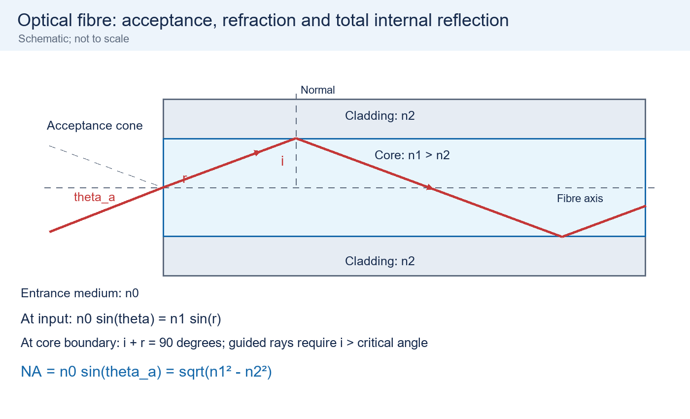

## Index profiles and propagation

[Open full image](assets/fibre-types.png)

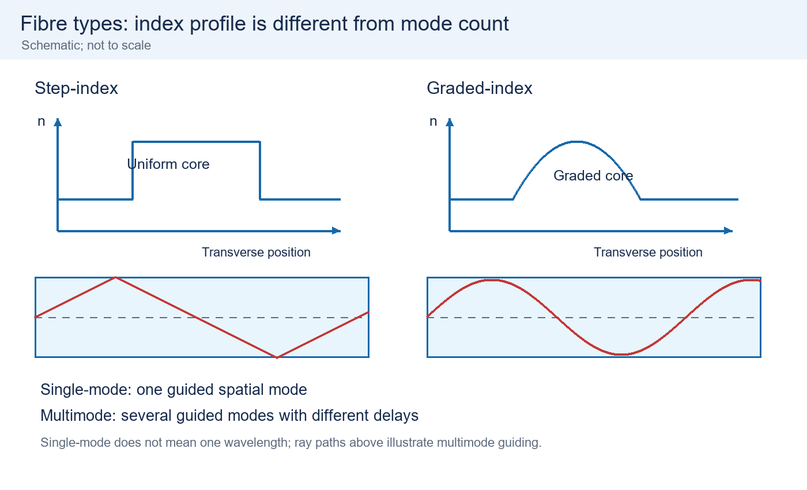

## Hologram recording and viewing

[Open full image](assets/holography.png)

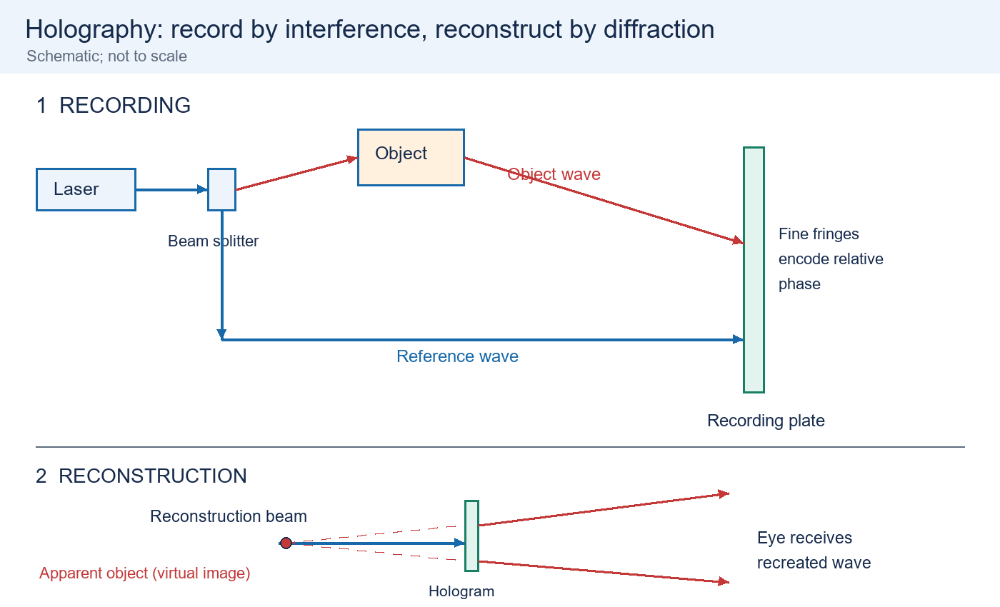

## SC, BCC and FCC

[Open full image](assets/cubic-cells.png)

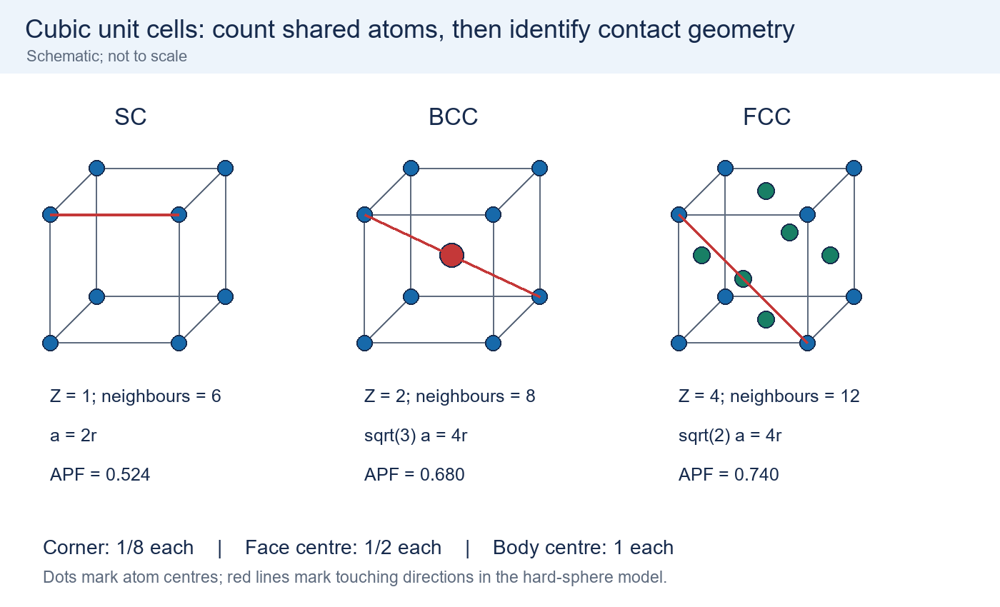

## Miller plane geometry

[Open full image](assets/miller.png)

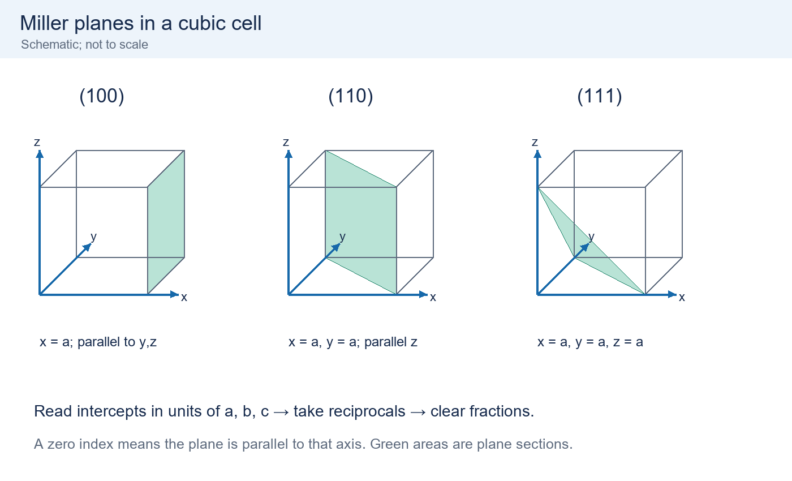

## Bragg diffraction

[Open full image](assets/bragg.png)

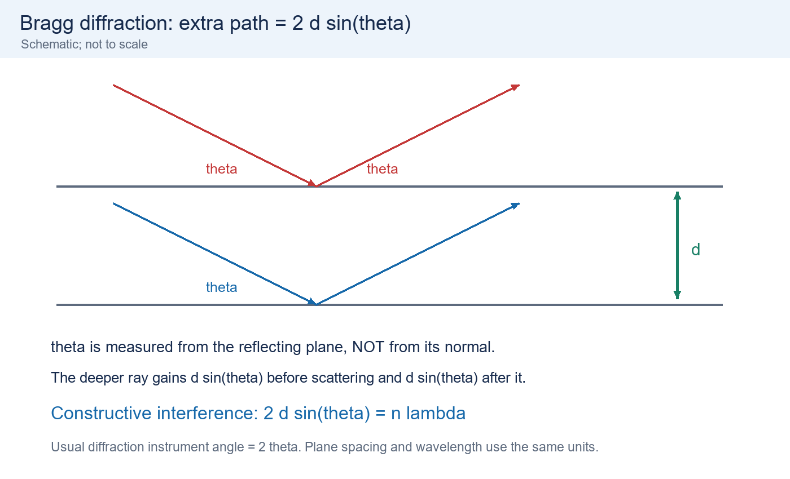

## Bands and junction field

[Open full image](assets/semiconductor.png)

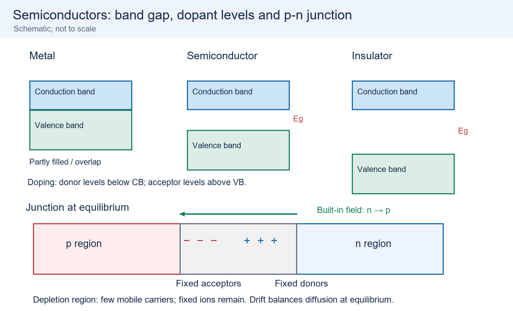

## Blackbody spectra

[Open full image](assets/blackbody.png)

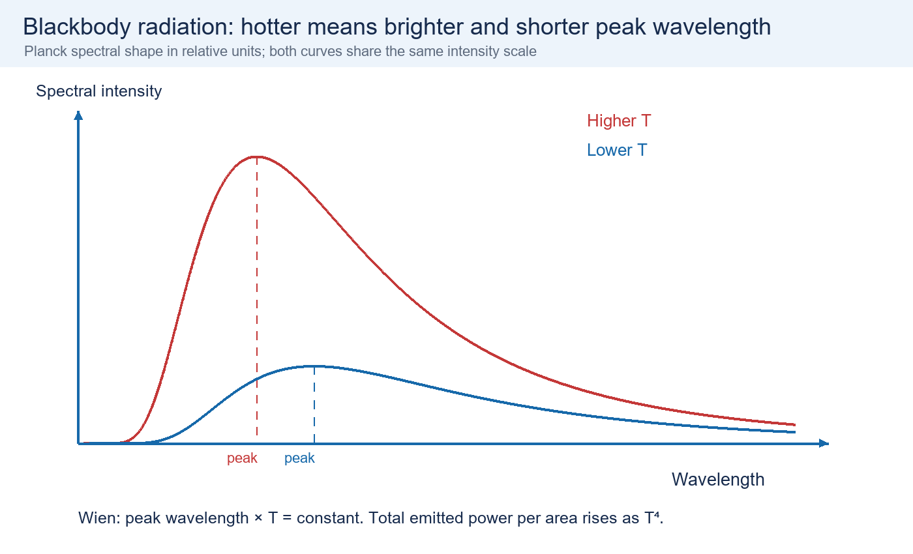

## Photoelectric and Compton arrangements

[Open full image](assets/photon-experiments.png)

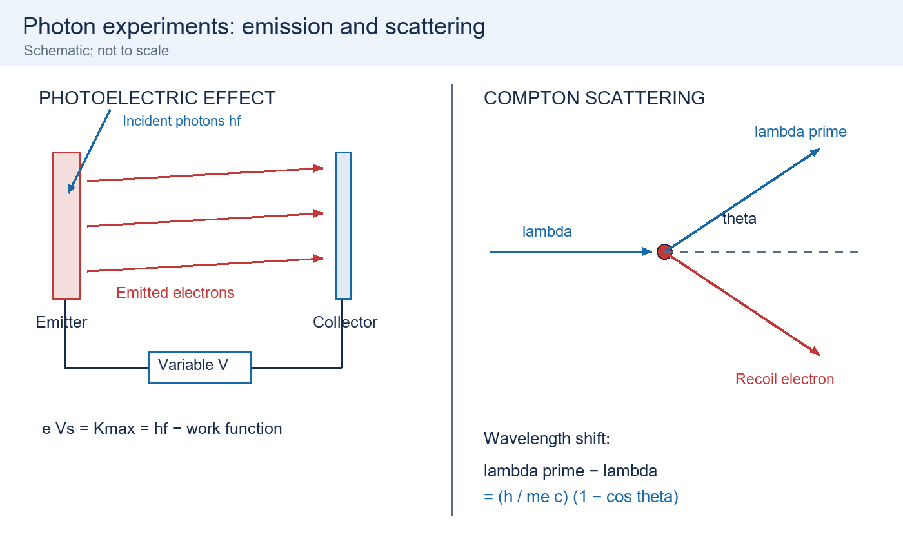

## Electron diffraction apparatus

[Open full image](assets/davisson-germer.png)

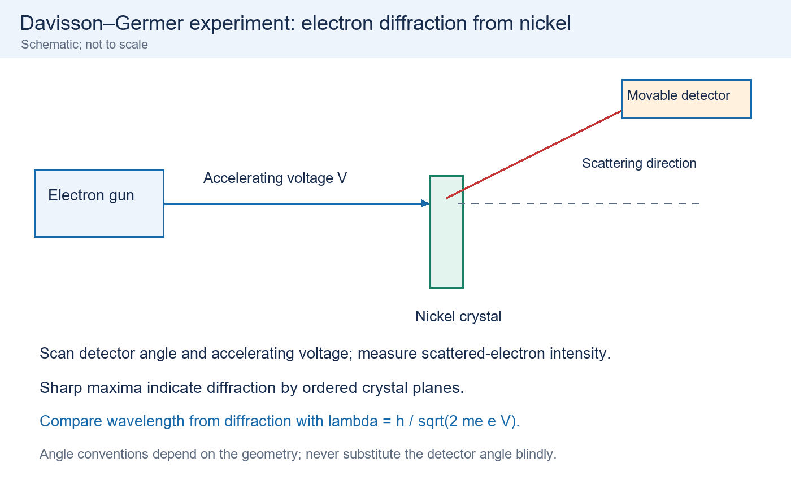

## Wave function and probability density

[Open full image](assets/wavefunction.png)

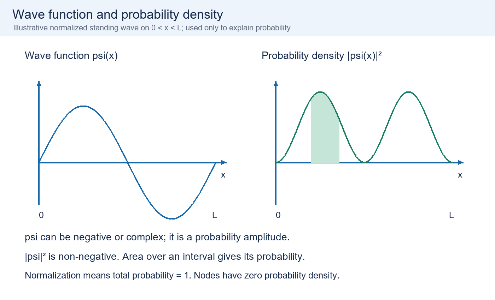

## Fermi distribution

[Open full image](assets/fermi.png)

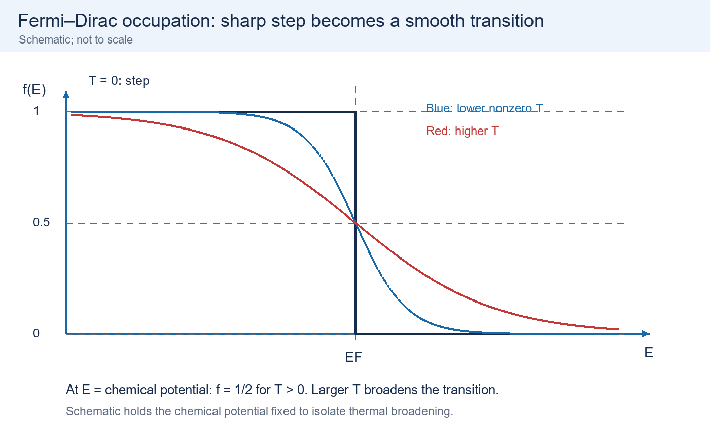

## Wells, wires and dots

[Open full image](assets/confinement.png)

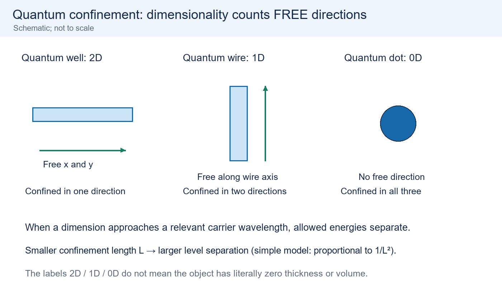

## Graphene and nanotube structures

[Open full image](assets/carbon.png)

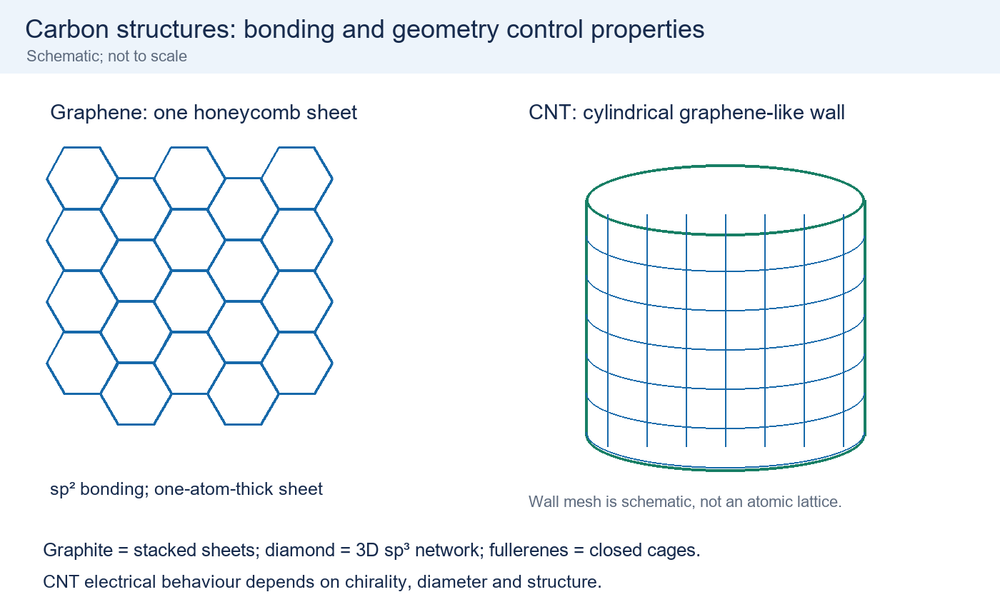
