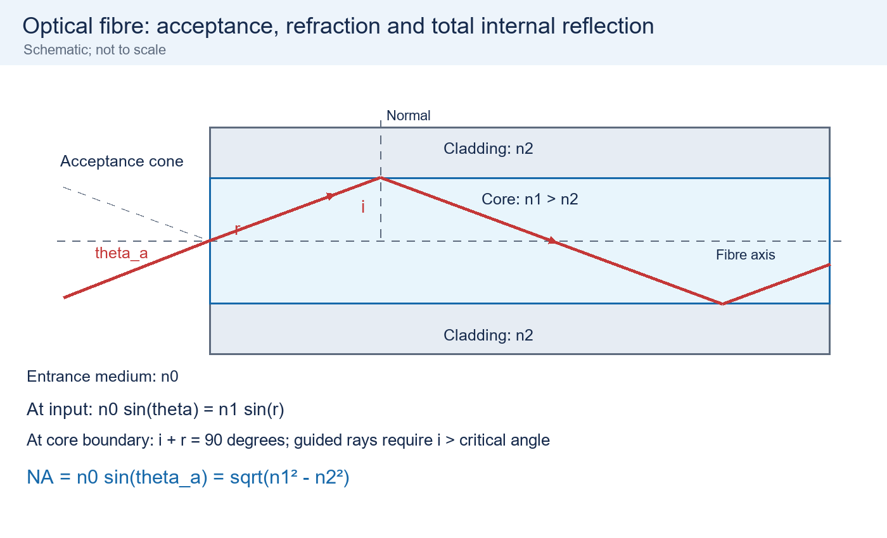
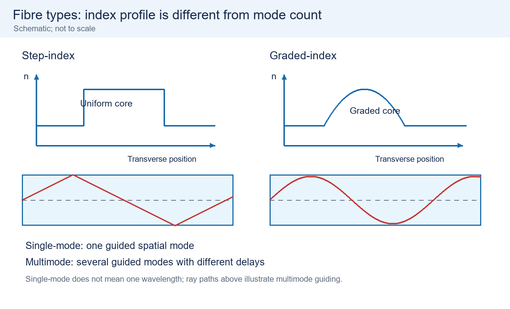
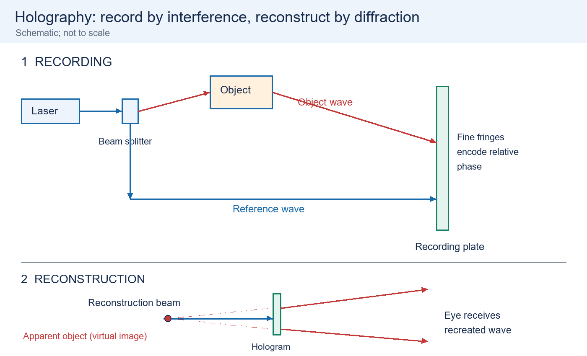

# Module 1 — Modern Optics

[[Physics Index|Index]] · [[Formula and Revision Guide|Final revision]]

> [!abstract] Learning route
> Learn refraction → total internal reflection → fibre acceptance → fibre types and losses → hologram recording and viewing. You need only right-triangle trigonometry, refractive index and the idea of interference. All questions below are newly generated practice unless explicitly labelled otherwise. Suggested marks are practice allocations, not a verified SurTech marking scheme.

## 1. Principle and construction of optical fibres

An optical fibre is a thin transparent waveguide that carries light along its length. The **core**, with refractive index $n_1$, is surrounded by **cladding**, with slightly smaller index $n_2$. A protective coating provides mechanical protection; it is not the light-guiding core. The essential condition is $n_1>n_2$.

Refractive index is $n=c/v$, where $c$ is the speed of light in vacuum and $v$ its phase speed in the material. Both speeds use m/s; $n$ has no unit. Snell's law at a flat boundary is $n_a\sin i=n_b\sin r$, with both angles measured **from the normal**.

When a ray travels from core to cladding, the refracted ray bends away from the normal. At the **critical angle** $i_c$, it runs along the boundary. Therefore

$$n_1\sin i_c=n_2\sin90^\circ,\qquad i_c=\sin^{-1}(n_2/n_1).$$

For incidence $i>i_c$, total internal reflection (TIR) occurs. Repeated TIR confines suitable rays to the core. This ray model is useful for explaining multimode fibres; a mode is more precisely an allowed electromagnetic field pattern. Single-mode propagation requires the wave description.

**Read the diagram:** the entrance face has its normal along the fibre axis. At the horizontal core boundary the normal is vertical. The external acceptance angle and internal reflection angle are therefore measured from different reference lines.

**Draw it in an exam:** draw a long core rectangle, cladding above and below, a dashed axis and a zigzag ray. Add $n_1>n_2$, the normal at a reflection point, and $i>i_c$. Then add a ray entering from air.

**Question (suggested 3 marks): Why does a fibre require cladding?**

**Model answer:** cladding provides a controlled lower-index boundary around the core, allowing TIR for suitable guided rays. It helps isolate the guiding boundary from the surroundings and reduces leakage caused by direct contact. The outer coating provides additional protection. Merely surrounding a core with a higher-index material would not satisfy TIR.

> [!tip] Remember
> TIR needs **high to low index**, and **incidence greater than critical**. Reflection alone does not imply TIR.

## 2. Acceptance angle and numerical aperture

**Acceptance angle $\theta_a$** is the maximum external angle, measured from the fibre axis, at which an incident meridional ray can be accepted for guided propagation in the ideal step-index model. Rotating this limiting ray around the axis produces an **acceptance cone**. The full cone angle is $2\theta_a$.

**Numerical aperture** measures light-accepting ability:

$$\mathrm{NA}=n_0\sin\theta_a=\sqrt{n_1^2-n_2^2}.$$

Here $n_0$ is the surrounding-medium index. NA is dimensionless. In air, $n_0\approx1$, so $\theta_a=\sin^{-1}(\mathrm{NA})$. In water or another medium use $\theta_a=\sin^{-1}(\mathrm{NA}/n_0)$.

### Guided derivation of NA

1. Let $r$ be the angle of the refracted ray inside the core to the axis. At the input face, Snell's law gives $n_0\sin\theta=n_1\sin r$.
2. The core boundary is parallel to the axis, so the incidence angle there is $i=90^\circ-r$.
3. At the acceptance limit, $i=i_c$, hence $\sin r_{\max}=\cos i_c$.
4. Use $\cos i_c=\sqrt{1-\sin^2i_c}=\sqrt{1-(n_2/n_1)^2}$.
5. Substitute: $n_0\sin\theta_a=n_1\sqrt{1-(n_2/n_1)^2}=\sqrt{n_1^2-n_2^2}$.

**Assumptions:** straight ideal step-index fibre; flat entrance perpendicular to the axis; meridional ray geometry; negligible absorption in this calculation. If an expression produces $\sin\theta_a>1$, the external-angle interpretation must be bounded by physically possible incidence; ordinary communication fibres have much smaller NA.

### Worked example A — basic acceptance

**Given:** $n_1=1.50$, $n_2=1.47$, air. **Find:** NA, acceptance half-angle and full cone angle.

**Principle and reason:** the indices determine the largest guided entrance angle, so use the NA expression. All indices are unitless; no length conversion is needed.

$$\mathrm{NA}=\sqrt{1.50^2-1.47^2}=\sqrt{0.0891}=0.2985.$$
$$\theta_a=\sin^{-1}(0.2985)=17.37^\circ,\qquad2\theta_a=34.74^\circ.$$

**Check:** NA is below one and the full cone is twice the half-angle. A small index contrast gives a moderately narrow acceptance cone.

### Worked example B — changing the external medium

**Given:** $n_1=1.48$, $n_2=1.46$, $n_0=1.33$. **Find:** $i_c$, NA and $\theta_a$.

**Approach:** the core/cladding pair sets $i_c$ and NA; the external medium changes the acceptance angle.

$$i_c=\sin^{-1}(1.46/1.48)=80.57^\circ,$$
$$\mathrm{NA}=\sqrt{2.1904-2.1316}=0.2425,$$
$$\theta_a=\sin^{-1}(0.2425/1.33)=10.50^\circ.$$

**Check:** in air this same fibre gives $14.03^\circ$; the external acceptance half-angle is smaller in water. Do not change the core/cladding critical angle merely because the input medium changed.

### Independent practice

1. A fibre in air has $n_1=1.60$, $n_2=1.50$. Find NA and half-angle.
2. A fibre has NA $0.22$ and core index $1.48$. Find its cladding index and acceptance half-angle in a medium of index $1.33$.

> [!success]- Answers and method
> 1. $\sqrt{2.56-2.25}=0.5568$; $\theta_a=33.83^\circ$.
> 2. Rearrange $n_2=\sqrt{n_1^2-\mathrm{NA}^2}=\sqrt{2.1904-0.0484}=1.4636$. Then $\theta_a=\sin^{-1}(0.22/1.33)=9.52^\circ$.

## 3. Propagation and classification

Two different classifications must be kept separate: **index profile** describes how refractive index changes across the fibre; **mode count** describes how many guided field patterns propagate.

| Type | Index profile and light propagation | Main consequence |
|---|---|---|
| Step-index | Uniform core index with abrupt drop at cladding; rays follow straight segments with reflections | Multimode rays can have substantially different travel times |
| Graded-index | Core index decreases gradually from centre toward edge; rays bend smoothly | Outer paths travel through lower-index, faster regions, reducing modal delay differences |
| Single-mode | Only the fundamental guided spatial mode at the operating wavelength; usually small core | Eliminates intermodal dispersion; chromatic dispersion can remain |
| Multimode | Many modes at the operating wavelength; usually larger core | Easier light coupling but differential modal delays can broaden pulses |

**Guided explanation:** a pulse launched into several modes does not necessarily arrive as one sharp pulse. Different modes have different group delays. In a step-index multimode fibre this is pronounced. A suitable graded profile compensates part of the delay because light travelling farther from the centre moves through lower-index material. Single-mode operation removes competition between different spatial-mode delays.

**Question (suggested 5 marks): Compare step-index and graded-index fibres.**

**Model answer:** define each profile, draw the two $n$ versus radial-position plots, show zigzag versus smoothly curved ray paths, then explain why graded-index multimode fibres reduce intermodal pulse broadening. End by noting that an index profile and a mode classification are different properties.

**Question (suggested 2 marks): Does single-mode mean single wavelength?**

**Answer:** no. A mode is an allowed field pattern. Several wavelengths can be carried while each operates in the single-mode regime. Similarly, “multimode” does not simply mean that the source contains multiple colours.

> [!tip] Memory cue
> **Step = sudden index change; graded = gradual change; mode = field pattern.**

## 4. Losses and pulse spreading

**Attenuation** is reduction in optical power along a fibre. Its causes include:

- **Absorption:** material or impurity absorption converts light energy to internal energy/heat.
- **Scattering:** microscopic refractive-index fluctuations redirect light, with some power lost from guided propagation.
- **Bending losses:** tight macrobends or small irregular microbends couple guided light into radiating or other lossy modes.
- **Joint losses:** misalignment, gaps and imperfect splices/connectors lose power at interfaces.

**Dispersion is different:** it spreads a pulse in time. Modal dispersion arises from different mode delays; chromatic dispersion arises because different spectral components travel with different group delays. Pulse overlap limits the data rate even if measurable power remains. This connects fibre physics to CSE networks.

The tracker requests basic losses; the following short numerical skill is useful supporting practice:

$$A_{\mathrm{dB}}=10\log_{10}\left(\frac{P_{in}}{P_{out}}\right),\qquad
\alpha=\frac{A_{\mathrm{dB}}}{L},\qquad
P_{out}=P_{in}10^{-\alpha L/10}.$$

$P_{in}$ and $P_{out}$ must use the same power unit; $L$ is typically km, so $\alpha$ is dB/km. These are **power** ratios: use 10, not 20.

**Worked A:** Given 2 mW input, 1 mW output over 3 km, find attenuation per km. Use a power ratio because both values are powers: $A=10\log_{10}2=3.010$ dB; $\alpha=3.010/3=1.003$ dB/km. Halving power corresponds to about 3 dB total, so the answer is consistent.

**Worked B:** Given $\alpha=0.25$ dB/km, $L=12$ km and $P_{in}=5$ mW, find output. Total loss $=3$ dB; $P_{out}=5(10^{-0.3})=2.506$ mW. No conversion is needed because the answer uses mW. A 3 dB loss approximately halves the power.

**Practice:** (1) 10 mW becomes 1 mW over 5 km; find $\alpha$. (2) 2 mW enters a 10 km fibre with $0.4$ dB/km; find output.

> [!success]- Solutions
> (1) $10\log_{10}(10)/5=2$ dB/km. (2) $2\times10^{-4/10}=0.7962$ mW. Ignore connector losses unless stated.

## 5. Holography — qualitative theory

**What to learn:** how interference records enough information to reconstruct an object's wavefront. Prerequisites: coherent waves have a stable phase relationship; interference intensity depends on relative phase.

A photograph directly records an intensity image. A hologram records an **interference pattern** between light scattered by the object and a coherent reference wave. The pattern encodes relative phase information as intensity variations. On suitable illumination, diffraction by the recorded structure reconstructs the object wavefront, producing depth and parallax.

### Recording

1. Use a coherent source, normally a laser, and split its light into object and reference beams.
2. Illuminate the object with the object beam. Scattered light reaches a photosensitive recording plate.
3. Direct the reference beam to the same plate without passing through the object.
4. Their overlapping waves form fine interference fringes. A stable setup is needed: motion during recording washes out fringes.
5. Develop or otherwise process the recording medium so its transmission or reflection varies with the recorded fringes.

The qualitative interference relation is $I=I_o+I_r+2\sqrt{I_oI_r}\cos\delta$, where $I_o,I_r$ are the object/reference intensities and $\delta$ is their phase difference. It explains **how phase information affects recorded intensity**; no full holographic derivation is required.

### Viewing and reconstruction

Illuminate the processed hologram with an appropriate reconstruction beam. Its fringe structure diffracts the light, generating a wave resembling the original object wave. The observer receives this reconstructed light and sees a virtual image at the apparent object position. Common arrangements also produce a conjugate real image and an undiffracted beam. Reconstruction conditions depend on hologram type; not every hologram must be viewed with a laser.

The image has parallax: moving the viewing position reveals a different perspective within the recorded angular range. A small piece of a hologram can often reconstruct the whole object's view because each region received scattered light from much of the object, but brightness, resolution and viewing range are reduced.

### Applications and answer structure

| Application | Physical reason |
|---|---|
| Security markings | Complex diffractive patterns produce distinctive depth/angle-dependent appearances |
| Holographic interferometry | Comparing recorded and changed wavefronts reveals small deformation or vibration |
| Three-dimensional display/documentation | Reconstructed wavefront preserves depth cues and parallax |
| Optical information storage, specialised systems | Information can be encoded through spatial interference patterns |

**Question (suggested 5 marks): Explain recording and reconstruction.** Start with the definition, draw the two stages separately, explain coherent splitting and fringe recording, then explain diffraction and the virtual image. Finish with two applications linked to their mechanisms.

**Question (suggested 2 marks): Why is a reference beam needed?** It converts relative phase differences into a measurable fringe-intensity pattern. Recording object intensity alone loses the relative phase information needed for ordinary holographic reconstruction.

**Common mistakes:** calling a hologram an ordinary 3D photograph; drawing only one beam during recording; treating recording and reconstruction as the same process; claiming phase is measured directly by photographic film.

> [!tip] Remember
> **Record by interference; reconstruct by diffraction.**

## 6. Module revision sheet

| Formula | Meaning and restriction |
|---|---|
| $\sin i_c=n_2/n_1$ | Core-to-cladding critical incidence; $n_1>n_2$ |
| $\mathrm{NA}=\sqrt{n_1^2-n_2^2}$ | Ideal step-index meridional acceptance; dimensionless |
| $\theta_a=\sin^{-1}(\mathrm{NA}/n_0)$ | External half-angle; degrees or radians as consistently chosen |
| $A=10\log_{10}(P_{in}/P_{out})$ | Power attenuation in dB; same power units |

**Derivation checklist:** [ ] critical-angle relation; [ ] NA from Snell's law and complementary angles. **Diagram checklist:** [ ] acceptance cone and TIR; [ ] index profiles; [ ] recording and reconstruction.

### Active recall — close the notes first

1. Why is $n_1>n_2$ necessary?
2. Which normal defines $i_c$, and which line defines $\theta_a$?
3. Can a single-mode fibre still disperse a pulse?
4. What compensates travel time in a graded-index fibre?
5. What is the difference between attenuation and dispersion?
6. Which process records a hologram and which reconstructs it?

> [!success]- Recall answers
> 1. TIR requires travel from higher to lower index. 2. $i_c$: normal to core boundary; $\theta_a$: fibre axis/input-face normal. 3. Yes, chromatic dispersion can remain. 4. Outer regions have lower index and higher light speed. 5. Power reduction versus time spreading. 6. Interference versus diffraction.

### Mixed practice test — suggested 20 marks

1. Define acceptance angle and NA, including the external-medium factor. (3)
2. Derive the ideal step-index NA expression with a labelled diagram. (5)
3. For NA $0.30$ in air find the half-angle and full cone angle. (2)
4. Compare step-index multimode and graded-index multimode propagation. (4)
5. Explain recording/reconstruction of a hologram and two applications. (6)

**Solutions/rubric:** 1: maximum accepted axial angle; $\mathrm{NA}=n_0\sin\theta_a$. 2: the five steps in Section 2, with both normals marked. 3: $17.46^\circ$, $34.92^\circ$. 4: compare abrupt/gradual profiles, zigzag/curved rays, delays and compensation. 5: coherent splitting, object/reference overlap, fringe recording, reconstruction by diffraction, plus security and deformation measurement with reasons.

| Study priority | Topics | Basis |
|---|---|---|
| First | TIR, NA derivation and numericals | Central dependency of the fibre syllabus |
| Next | Fibre comparisons, losses | Explicit tracker items and strong short-answer practice |
| Then, without skipping | Holography stages and applications | Entire second branch of this module |

These priorities are syllabus-based judgment, not verified SurTech question frequency.

## Sources for this module

Local Young & Freedman, *University Physics*, 13th ed., §33.3 printed pp.1088–1089 (PDF pp.1114–1115), §36.8 printed pp.1211–1212 (PDF pp.1237–1238), inspected for TIR and holography. Index-profile explanation and original problems are instructional synthesis. See [[Sources and Coverage]] for the full resource audit and supplementary teaching sources.
