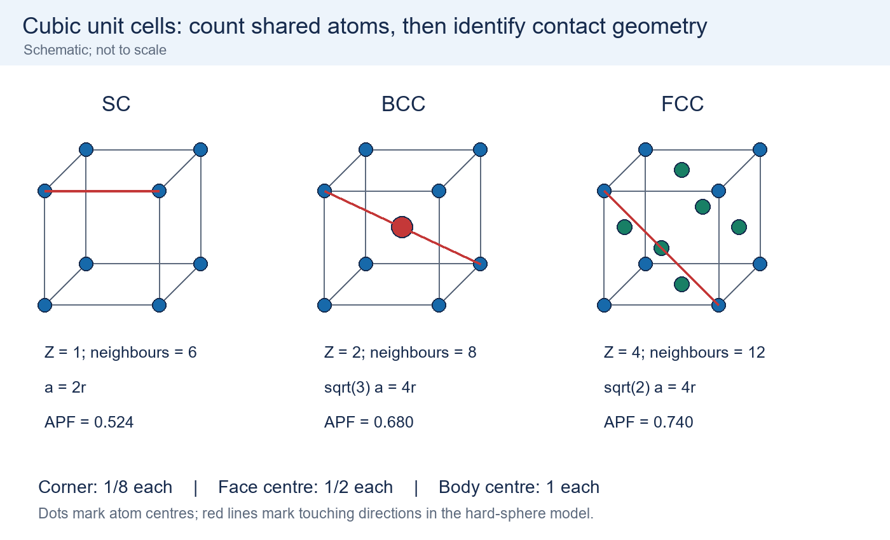
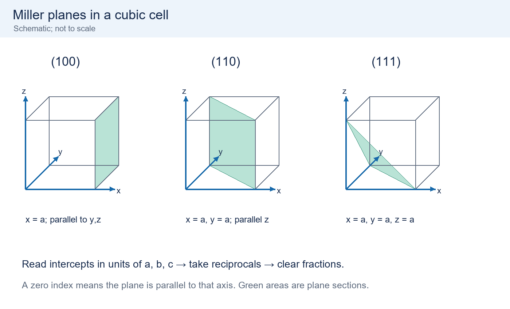
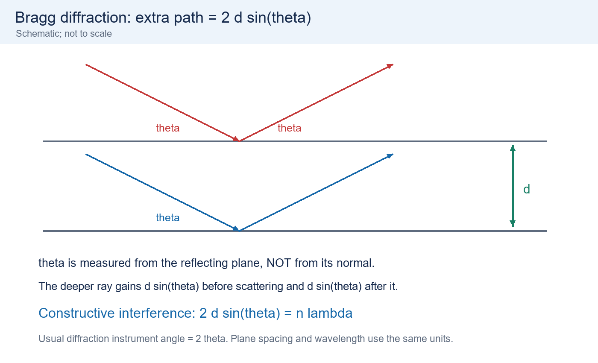
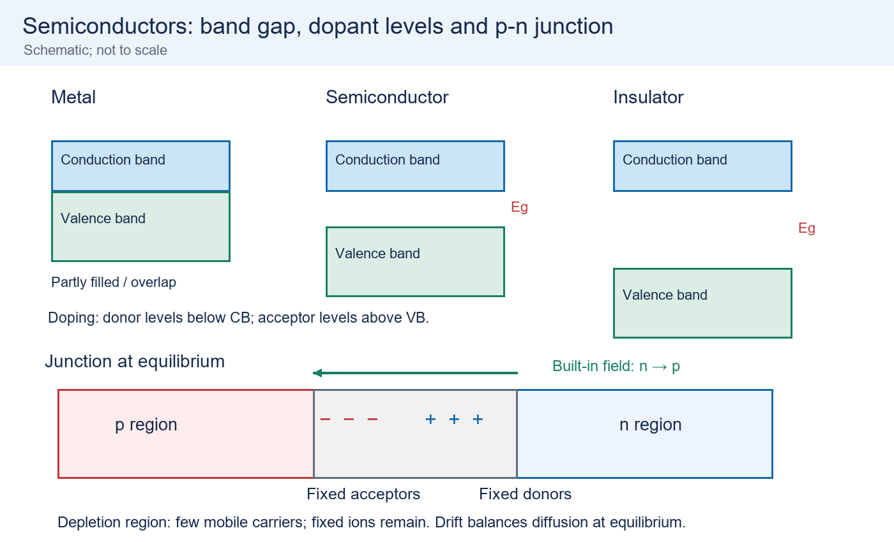

# Module 2 — Solid State Physics

[[Physics Index|Index]] · [[Formula and Revision Guide|Final revision]]

> [!abstract] Learning route
> Begin with order in solids, then lattice + basis, cubic-cell geometry, plane indexing and X-ray diffraction. Finish with energy bands, doping and junction formation. Prerequisites: fractions, reciprocals, Pythagoras and charge conservation. Questions are original practice; marks are suggested unless a past-paper source is explicitly identified.

## 1. Structure of solids

Atoms, ions or molecules in a solid stay near equilibrium positions while vibrating. The arrangement and bonding determine many material properties. “Solid” does not necessarily mean “crystalline.”

| Feature | Crystalline solid | Amorphous solid |
|---|---|---|
| Definition | Long-range periodic positional order in an ideal crystal | No long-range periodic positional order; short-range order can remain |
| Examples | Copper, sodium chloride, crystalline silicon | Ordinary window glass, many amorphous polymers |
| Heating | A pure ideal crystal has a definite melting temperature at specified pressure | Often softens over a range and shows a glass transition |
| Directional properties | Can be anisotropic; depends on property and symmetry | Often macroscopically isotropic |
| Diffraction | Sharp diffraction features from ordered planes | Broad diffuse features |

Avoid saying every crystalline property is anisotropic: cubic crystals can have isotropic values of some properties. A polycrystalline sample contains many differently oriented crystallites and can also behave approximately isotropically.

**Question (suggested 3 marks): Differentiate amorphous and crystalline solids.** Define the type of order, give one correct example of each, then compare diffraction and thermal behaviour. This is stronger than merely writing “regular/irregular.”

## 2. Lattice, basis, unit cell and Bravais lattices

**Lattice:** an infinite periodic set of points with identical surroundings at every point. It is a geometrical construction, not a list of actual atoms.

**Basis:** the atom or group of atoms attached identically to every lattice point.

$$\text{Crystal structure}=\text{lattice}+\text{basis}.$$

**Unit cell:** a region which repeats by translation to generate the lattice/crystal. A primitive cell contains one lattice point in total after sharing is counted. A conventional cell may contain more than one lattice point because it displays symmetry conveniently.

**Example:** a simple-cubic lattice with a one-atom basis places the same atom at each lattice point. A multi-atom basis can create a more complicated structure without changing the underlying lattice. Do not confuse an atom with a lattice point in every possible crystal.

The **14 Bravais lattices** are the distinct three-dimensional translational lattice types, distributed across seven crystal systems:

| System | Cell parameters | Allowed conventional centring |
|---|---|---|
| Cubic | $a=b=c$; $\alpha=\beta=\gamma=90^\circ$ | P, I, F (3) |
| Tetragonal | $a=b\ne c$; all angles $90^\circ$ | P, I (2) |
| Orthorhombic | Three generally unequal edges; all angles $90^\circ$ | P, C, I, F (4) |
| Monoclinic | Three generally unequal edges; $\alpha=\gamma=90^\circ$, $\beta\ne90^\circ$ | P, C (2) |
| Triclinic | General edge lengths and angles; no required right angles | P (1) |
| Hexagonal | $a=b\ne c$; $\alpha=\beta=90^\circ$, $\gamma=120^\circ$ | P (1) |
| Trigonal/rhombohedral | Rhombohedral setting: equal edges, equal non-right angles | R (1) |

P = primitive; I = body-centred; F = face-centred; C = base-centred. The count is $3+2+4+2+1+1+1=14$. The detailed parameter table supports “Bravais lattices”; the tracker gives particular emphasis to SC, BCC and FCC.

**Question (suggested 2 marks): Is BCC primitive?** The conventional cubic BCC cell contains two lattice points, so that particular cell is not primitive. A smaller primitive cell can nevertheless be chosen for the same BCC lattice.

## 3. SC, BCC, FCC and coordination number

The sketches show atom **centres**, not touching hard spheres. Back edges are schematic. To redraw: draw two offset squares and join corresponding corners; add the body centre for BCC or all six face centres for FCC, including hidden faces.

### Counting shared atoms

- A corner belongs to eight neighbouring cubes: contribution $1/8$.
- A face-centre atom belongs to two cells: contribution $1/2$.
- A body-centre atom belongs to just one cell: contribution $1$.

**Coordination number (CN)** is the number of nearest neighbours of a chosen atom in the structure. It is not the number of atoms in a unit cell.

| Structure | Atoms per conventional cell $Z$ | Contact direction | Radius–edge relation | CN | Examples |
|---|---:|---|---|---:|---|
| SC | $8/8=1$ | Edge | $a=2r$ | 6 | Polonium under suitable conditions |
| BCC | $8/8+1=2$ | Body diagonal | $\sqrt3a=4r$ | 8 | $\alpha$-iron, tungsten |
| FCC | $8/8+6/2=4$ | Face diagonal | $\sqrt2a=4r$ | 12 | Copper, aluminium |

**Why these CN values?** In SC, neighbours lie along the positive and negative coordinate axes: six. In BCC, the body-centre atom has the eight corners as nearest neighbours. In FCC, a selected atom has four nearest neighbours in its plane, four in the plane above and four below.

> [!tip] Remember
> **SC/BCC/FCC: atoms 1–2–4, neighbours 6–8–12; touching directions edge–body–face.**

## 4. Atomic packing factor

The **atomic packing factor (APF)** is the fraction of unit-cell volume occupied by atoms in the equal hard-sphere model:

$$\mathrm{APF}=\frac{Z(4\pi r^3/3)}{a^3}.$$

$r$ and $a$ must use the same length unit. APF is dimensionless. The model is geometric; actual electron densities do not have rigid sphere boundaries.

### Derivations to learn

**SC:** adjacent corner atoms touch along an edge: $a=2r$. Thus $\mathrm{APF}=(4\pi r^3/3)/(8r^3)=\pi/6=0.524$.

**BCC:** the body diagonal traverses corner radius + body diameter + opposite corner radius, so $\sqrt3a=4r$. With $Z=2$:

$$\mathrm{APF}=\frac{2(4\pi r^3/3)}{(4r/\sqrt3)^3}=\frac{\sqrt3\pi}{8}=0.680.$$

**FCC:** the face diagonal traverses the same four radii through a face centre: $\sqrt2a=4r$. With $Z=4$:

$$\mathrm{APF}=\frac{4(4\pi r^3/3)}{(2\sqrt2r)^3}=\frac{\pi}{3\sqrt2}=0.740.$$

**Question (suggested 3 marks): Why is FCC more closely packed than BCC?** State both APFs, explain that a larger fraction of the conventional-cell volume is occupied in the hard-sphere model, and relate this to their contact geometries. Greater atom count alone is not a valid explanation because cell sizes differ.

### Worked geometry and packing examples

**A — basic:** Given SC atomic radius $r=0.15$ nm, find $a$ and APF. Edge contact gives $a=2r=0.30$ nm $=3.0\times10^{-10}$ m. APF $=\pi/6=0.524$. Check: packing fraction is independent of the chosen radius for the same structure.

**B — exam style:** Given BCC $a=0.288$ nm, find $r$ and unoccupied volume percentage. Use body-diagonal contact: $r=\sqrt3a/4=0.1247$ nm $=1.247\times10^{-10}$ m. APF $=0.6802$; unoccupied fraction $=1-0.6802=0.3198$, or $31.98\%$. Check: $r<a/2$ because atoms do not touch along BCC edges.

**Practice:** (1) FCC $a=0.400$ nm: find $r$, $Z$, CN. (2) BCC radius $0.125$ nm: find $a$ and APF.

> [!success]- Answers
> (1) $r=\sqrt2a/4=0.1414$ nm; $Z=4$, CN $=12$. (2) $a=4r/\sqrt3=0.2887$ nm; APF $=0.6802$.

## 5. Miller indices and Miller planes

Miller indices $(hkl)$ specify the orientation of lattice planes using reciprocals of their intercepts with the crystallographic axes, measured in units of $a,b,c$. A zero index means the plane is parallel to that axis. A negative index is written with a bar, for example $(\bar1 1 0)$.

**Guided method — intercept, reciprocal, clear fractions:**

1. Express intercepts as multiples of the cell edges, not raw lengths in unlike units.
2. Take reciprocals. A parallel-axis intercept is $\infty$, whose reciprocal is zero.
3. Clear fractions to obtain the smallest appropriate integer orientation indices.
4. Put the result in round brackets. If the plane passes through the origin, choose a parallel plane or shift the origin first.

$(hkl)$ denotes a plane orientation/set of parallel planes; $[uvw]$ denotes a direction. In cubic crystals the direction $[hkl]$ is normal to $(hkl)$, but this is not generally true for non-cubic cells. Braces $\{hkl\}$ collect symmetry-equivalent planes.

**Worked A:** Given intercepts $a,2b,\infty c$, find indices. In cell units they are $(1,2,\infty)$; reciprocals $(1,1/2,0)$; multiply by 2 → **$(210)$**. Check: $l=0$ correctly indicates parallelism to $c$.

**Worked B:** Given intercepts $2a,3b,4c$, find orientation. Reciprocals $(1/2,1/3,1/4)$; multiply by the least common multiple 12 → **$(643)$**. The representative nearest plane has intercepts $a/6,b/4,c/3$; it is parallel to the stated plane. Check reciprocal ratios, not the absolute offset from the origin.

**Practice:** (1) $a,\infty b,c$. (2) $-a,2b,\infty c$.

> [!success]- Answers
> (1) $(101)$. (2) Reciprocals $(-1,1/2,0)$, multiply by 2: $(\bar2 1 0)$.

### Interplanar spacing in cubic crystals

$$d_{hkl}=\frac{a}{\sqrt{h^2+k^2+l^2}}.$$

Here $d$ and $a$ are lengths, e.g. nm. This expression is for cubic geometry, not arbitrary crystals. Brief derivation: a representative plane is $hx+ky+lz=a$, with $x,y,z$ in physical length units. Its perpendicular distance from the parallel origin plane is the plane constant divided by the normal-vector magnitude, giving the expression above. Equivalently, project a perpendicular of length $d$ onto the three axes and use the squared direction cosines summing to one.

**Worked A:** $a=0.400$ nm; find $d_{110}$. Use the cubic formula: $0.400/\sqrt2=0.2828$ nm. **Worked B:** $d_{111}=0.208$ nm; find $a$. Rearrange: $a=d\sqrt3=0.3603$ nm. Check: for nonzero integer indices of these planes, $d\le a$.

**Practice:** (1) $a=0.300$ nm, find $d_{100},d_{111}$. (2) $d_{200}=0.150$ nm, find $a$.

> [!success]- Answers
> (1) $0.300$ nm and $0.1732$ nm. (2) $a=2d=0.300$ nm. Geometrical spacing does not by itself guarantee an allowed X-ray peak; structure-factor selection rules can suppress reflections.

## 6. Bragg's equation and applications

X-ray wavelengths are comparable to atomic-plane separations, so waves scattered by successive crystal planes can interfere. **Bragg's condition** for a constructive peak is

$$2d\sin\theta=n\lambda,\qquad n=1,2,3,\ldots$$

$\theta$ is the **glancing angle to the planes**, $d$ is plane spacing, $\lambda$ is wavelength and $n$ is diffraction order. $d,\lambda$ must share units. The angle between incident and diffracted beams in the usual diffraction geometry is $2\theta$.

### Guided derivation

Draw two parallel planes a distance $d$ apart and two parallel incident rays making angle $\theta$ with the planes. The ray scattered from the lower plane travels farther before scattering and again after scattering. Project the plane separation onto each ray direction: each extra segment is $d\sin\theta$. Total extra path is $2d\sin\theta$. Constructive interference requires an integer number of wavelengths, hence $2d\sin\theta=n\lambda$.

**Applications:** calculate $d$ from known wavelength and peak angle; determine an unknown wavelength using known crystal spacing; infer lattice parameter after indexing peaks; compare diffraction patterns to identify crystalline phases. Bragg's equation alone does not uniquely identify an unknown crystal from one peak.

**Worked A — spacing:** Given first-order $\theta=30^\circ$ and $\lambda=0.154$ nm, find $d$. A constructive peak gives $d=n\lambda/(2\sin\theta)=0.154/(2\times0.5)=0.154$ nm. Check: both sides of Bragg's equation are lengths.

**Worked B — recorded angle:** Given cubic $a=0.400$ nm, an allowed $(200)$ reflection and $\lambda=0.154$ nm, find the detector angle. First $d_{200}=a/2=0.200$ nm. Then $\sin\theta=0.154/(0.400)=0.385$, so $\theta=22.64^\circ$ and **$2\theta=45.29^\circ$**. Check the sine is below one; do not report $\theta$ if asked for $2\theta$.

**Practice:** (1) First order, $d=0.200$ nm, $\lambda=0.100$ nm: find $\theta$. (2) A first-order peak at $2\theta=60^\circ$ has $\lambda=0.154$ nm: find $d$.

> [!success]- Answers
> (1) $\theta=\sin^{-1}(0.25)=14.48^\circ$. (2) Use $\theta=30^\circ$ to obtain $d=0.154$ nm.

## 7. Physics of semiconductors and energy bands

**Intuition:** an electron can conduct when there are nearby available energy states into which its motion can change. In a solid, interactions between many atoms turn individual atomic energy levels into closely spaced **bands**. A **forbidden energy gap** has no allowed bulk electron states in the ideal band picture.

The **valence band (VB)** is the highest filled band at zero temperature in the simple intrinsic semiconductor picture. The **conduction band (CB)** above it can carry excited electrons. Band gap $E_g=E_c-E_v$ is measured in joules or electronvolts; $1\,\mathrm{eV}=1.602\times10^{-19}$ J.

| Material | Band explanation | Typical consequence |
|---|---|---|
| Metal | Partly occupied band or overlapping bands with nearby empty states | Readily conducts |
| Insulator | Filled VB, empty CB, relatively large gap | Very few thermally generated carriers under ordinary conditions |
| Semiconductor | Smaller gap, carrier population controllable by temperature, light and doping | Intermediate, strongly controllable conductivity |

There is no universal gap boundary that classifies every material at every temperature. For orientation, silicon's gap is about 1.1 eV near room temperature. “Semiconductor” does not mean it always conducts exactly half as well as a metal.

### Electrons and holes

An electron excited from VB to CB leaves an empty valence state, a **hole**. A neighbouring valence electron can fill the vacancy, leaving a new vacancy behind. This collective motion acts as a positively charged mobile carrier, with effective charge $+e$. A hole is not a proton or a physically detached positive ion.

With an applied electric field, electron drift is opposite to the field and hole drift is along it. Both contribute conventional current along the field.

**Question (suggested 3 marks): Explain a hole.** Define the missing valence electron state; describe neighbouring-electron filling; explain the apparent positive-charge motion and distinguish it from a stationary dopant ion.

## 8. Intrinsic and extrinsic semiconductors

**Intrinsic:** an ideally pure semiconductor. Thermal excitation creates electron–hole pairs, so carrier number densities satisfy $n=p=n_i$. These densities are counts per m³. More thermal excitation normally increases intrinsic carrier density strongly.

**Extrinsic:** conductivity is controlled by deliberately added dopants.

| Property | n-type | p-type |
|---|---|---|
| Dopant in Si/Ge | Pentavalent donor, e.g. phosphorus | Trivalent acceptor, e.g. boron |
| Mechanism | Four valence electrons form bonds; the fifth is weakly bound and can enter CB | Dopant accepts a valence electron, leaving a mobile hole |
| Majority/minority carriers | Electrons / holes | Holes / electrons |
| Ion after ionisation | Fixed positive donor ion | Fixed negative acceptor ion |
| Impurity level | Near and below CB edge | Near and above VB edge |
| Fermi-level trend | Toward CB | Toward VB |

Both bulk materials can remain electrically neutral: mobile charge is balanced by fixed ionised dopants. Doping changes carrier concentration without requiring the entire specimen to carry net charge.

For context, conductivity is $\sigma=e(n\mu_n+p\mu_p)$, where $\mu_n,\mu_p$ are mobilities in m²/(V·s), so $\sigma$ is S/m. This is a useful explanation of why carrier density matters; extensive transport numericals are not required by the tracker.

**Question (suggested 5 marks): Compare intrinsic and extrinsic semiconductors.** State purity/doping, pair generation versus donor/acceptor action, equal versus unequal carrier densities, majority/minority carriers, and the role of impurity levels. Draw the relevant band sketches.

> [!tip] Remember
> **Donor → electron → n-type. Acceptor → hole → p-type.** The names identify the majority carriers, not the net specimen charge.

## 9. p-n junction

A p-n junction is the boundary between p-type and n-type regions in one semiconductor structure.

### Formation in five steps

1. Initially electrons are numerous on the n side and holes on the p side.
2. Concentration gradients cause electrons to diffuse n→p and holes p→n.
3. Recombination near the interface removes many mobile carriers.
4. Fixed **negative acceptor ions on the p side** and **positive donor ions on the n side** remain. This forms a space-charge/depletion region, depleted mainly of mobile majority carriers.
5. The resulting built-in electric field points **n→p**, opposing further majority-carrier diffusion. At equilibrium drift and diffusion currents balance; net current is zero.

**Forward bias:** p connected to positive, n to negative. Applied voltage lowers the barrier and usually narrows depletion width; majority carriers cross more readily and current grows.

**Reverse bias:** p to negative, n to positive. The barrier and depletion width increase; a small minority-carrier reverse current remains until breakdown mechanisms become important. Do not claim the reverse current is identically zero.

**Question (suggested 5 marks): Explain junction formation with a diagram.** Draw p on the left and n on the right; put fixed minus ions on the left depletion side, plus ions on the right; draw the electric field from right to left. Explain diffusion, recombination, space charge, barrier formation and equilibrium balance in that order.

**CSE connection:** controlling carriers in semiconductor junctions underlies diodes and transistor circuits. Transistor derivations are beyond this tracker.

## 10. Module revision and practice

| Formula or fact | Units/condition |
|---|---|
| $Z=1,2,4$; CN $=6,8,12$ for SC/BCC/FCC | Equal-atom conventional cubic structures |
| APF $=Z(4\pi r^3/3)/a^3$ | Dimensionless hard-sphere model |
| $d_{hkl}=a/\sqrt{h^2+k^2+l^2}$ | Cubic crystals; lengths in same unit |
| $2d\sin\theta=n\lambda$ | Glancing angle; constructive diffraction |
| Intrinsic $n=p$ | Electron/hole number densities, m⁻³ |

**Derivation checklist:** [ ] three radius–edge relations; [ ] APFs; [ ] cubic spacing; [ ] Bragg path difference. **Diagram checklist:** [ ] SC/BCC/FCC; [ ] (100)/(110)/(111); [ ] Bragg; [ ] bands/dopant levels; [ ] junction ions and field.

### Active recall

1. Why does a corner atom count as $1/8$?
2. Is coordination number equal to atoms per cell?
3. What index represents an infinite intercept?
4. Does a diffraction instrument's $2\theta$ equal the Bragg angle?
5. Why does a donor become positively charged?
6. Which way does the built-in field point?
7. Why is equilibrium current zero despite carrier motion?

> [!success]- Answers
> 1. Eight cubes share it. 2. No: nearest neighbours versus effective cell content. 3. Zero. 4. No; halve it. 5. It loses a weakly bound electron. 6. From n-side positive donors toward p-side negative acceptors. 7. Drift and diffusion contributions cancel.

### Mixed test — suggested 25 marks

1. Explain lattice, basis and unit cell with one example. (4)
2. Derive FCC packing factor. (5)
3. Index a plane with intercepts $2a,b,\infty c$. (2)
4. For $a=0.360$ nm and $\lambda=0.154$ nm, find first-order $\theta$ for an allowed (111) reflection. (4)
5. Compare n-type and p-type semiconductors. (4)
6. Explain junction formation and biasing using a labelled sketch. (6)

**Solutions:** 1: geometric periodic points + repeated atomic motif; repeating volume. 2: $Z=4$, $4r=\sqrt2a$, APF $=\pi/(3\sqrt2)=0.740$. 3: $(120)$. 4: $d=0.360/\sqrt3=0.20785$ nm; $\sin\theta=0.154/(2d)=0.37047$; $\theta\approx21.74^\circ$. 5: donors/electrons versus acceptors/holes, fixed-ion charges and band-level locations. 6: the five formation steps, field n→p, forward lowers barrier, reverse raises it.

| Priority | Topics | Basis |
|---|---|---|
| First | Cubic geometry, APF, Miller indices, Bragg | Several explicit numerical/derivation skills; overlap with the comparison paper |
| Next | Bands, carriers, doping, p-n junction | Complete semiconductor branch of tracker |
| Short daily recall | Definitions, examples, 14 Bravais lattices | Supports accurate short answers |

No SurTech recurrence rates are inferred from the comparison paper.

## Sources

Young & Freedman §36.6, printed pp.1205–1206 (PDF pp.1231–1232), and §§42.3–42.7, selected printed pp.1412–1426 (PDF offset +26), inspected for diffraction, structure, bands and carriers. Original geometry derivations and numerical problems use these physical principles. The external [OpenStax semiconductor discussion](https://openstax.org/books/university-physics-volume-3/pages/9-6-semiconductors-and-doping) was cross-checked; its online text contains a majority-carrier typo, so the local textbook was used to resolve the discrepancy. See [[Sources and Coverage]].
