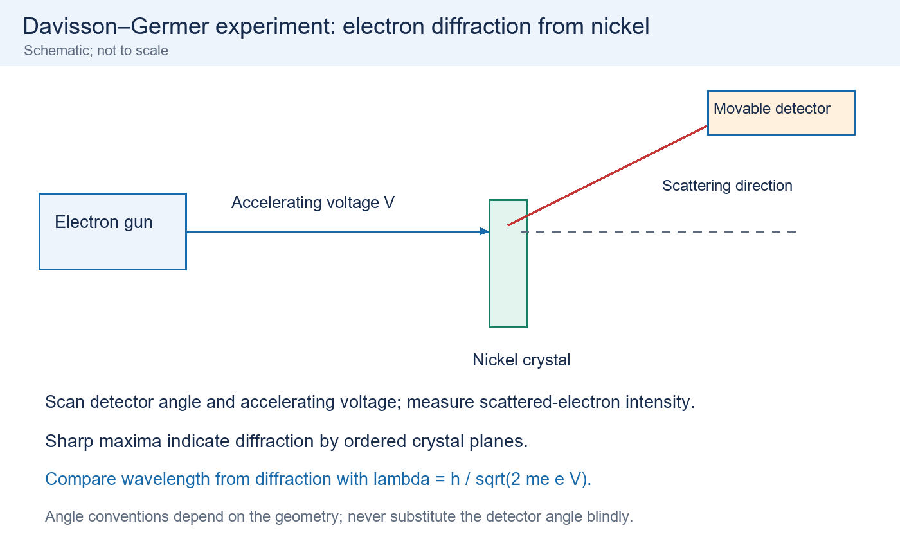
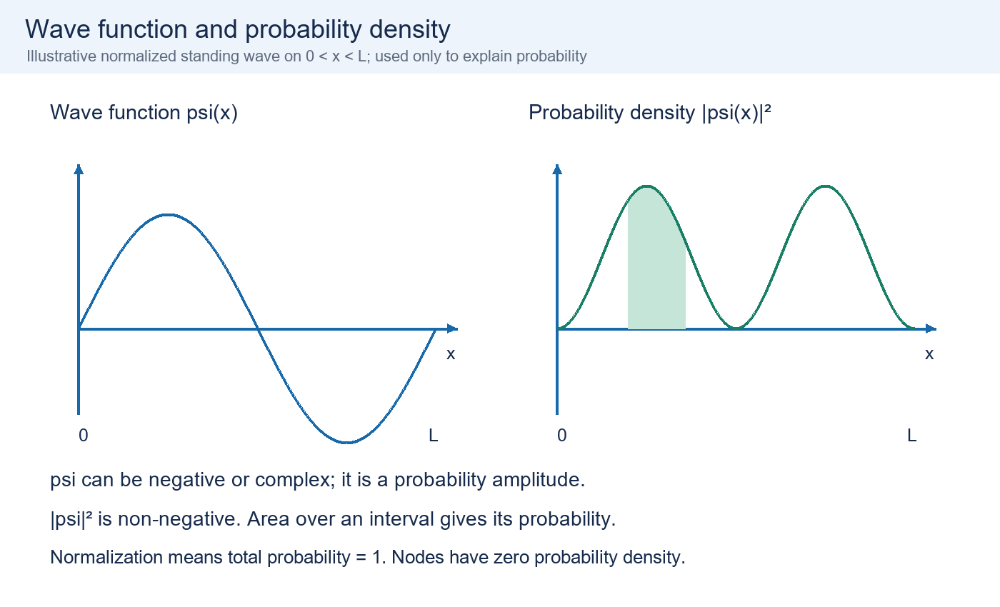
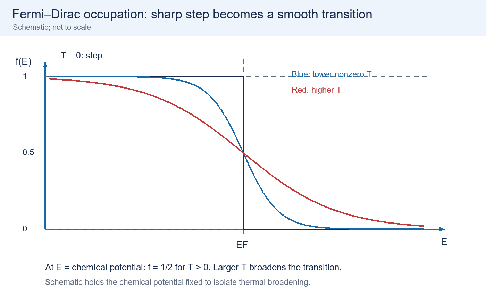

# Module 3 — Quantum and Statistical Mechanics

[[Physics Index|Index]] · [[Formula and Revision Guide|Final revision]]

> [!abstract] Learning route
> Experimental failures of classical physics → [[glossary/photon|photons]] → matter waves → wave functions and uncertainty → statistics of many particles. This is the largest tracker module: study it in three sittings. All practice below is newly generated unless identified otherwise. Marks are suggested.

**Constants:** $h=6.626\times10^{-34}$ J·s; $\hbar=h/(2\pi)=1.055\times10^{-34}$ J·s; $c=2.998\times10^8$ m/s; $m_e=9.109\times10^{-31}$ kg; $e=1.602\times10^{-19}$ C; $k_B=1.381\times10^{-23}$ J/K $=8.617\times10^{-5}$ eV/K. Useful shortcut: $hc\approx1240$ eV·nm. A nanometre is $10^{-9}$ m; an ångström is $10^{-10}$ m; a picometre is $10^{-12}$ m.

## Read the symbols before calculating

Symbols are local labels: the same letter can mean something different in another topic. Read the equation and units before choosing a formula. A subscript labels a particular quantity; it is not a factor to multiply.

| Symbol | Read it as | Meaning and unit |
|---|---|---|
| $h,\hbar$ | h, h bar | Planck constant and h divided by two pi; J s |
| $f,\nu$ in [[glossary/photon\|photon]] formulas | frequency, nu | Wave cycles per second; hertz. These denote the same frequency here |
| $\omega,k$ | omega, angular wavenumber | [[glossary/phase\|Phase]] change per time (rad/s) and distance (rad/m) |
| $\psi,\psi^*$ | psi, psi conjugate | Quantum amplitude and its complex conjugate; multiplying them gives density |
| $\phi,V_s$ | [[glossary/work-function\|work function]], [[glossary/stopping-potential\|stopping potential]] | Removal energy (J or eV) versus stopping voltage (V) |
| $\Delta x,\Delta p_x$ | position spread, momentum spread | Statistical spreads, not the coordinate and momentum themselves |
| $k_B,T$ | Boltzmann constant, temperature | J/K (or eV/K) and absolute temperature in K |
| $\mu$ | mu | [[glossary/chemical-potential\|Chemical potential]], an energy; this is different from semiconductor mobility |
| $f(E)$ | f of E | FD occupation probability; this f is not light frequency |
| $W,S$ | [[glossary/thermodynamic-probability\|multiplicity]], [[glossary/entropy\|entropy]] | [[glossary/microstate\|Microstate]] count and entropy (J/K); W here is not power in watts |

> [!tip] Understand it, then teach it back
> Start each topic with its plain-language explanation. Read the original equations and examples next. Close the note and answer the teach-back question in your own words. Linked scientific terms open a short definition: hover on the website, or open the linked note in Obsidian. On phones, tap a term for its definition. These are original teaching explanations, not quotations from Richard Feynman.

## 1. Inadequacy of classical physics and quantization

### Start with observations that the old model cannot explain

A theory earns its place by predicting observations. Classical wave reasoning explains many optical effects, but particular assumptions about continuous energy exchange fail for [[glossary/blackbody|blackbody]] radiation and photoelectric emission. Quantum physics changes those microscopic rules while retaining successful classical predictions in suitable limits.

The idea of [[glossary/quantization|quantization]] is like allowing only particular notes on a constrained vibrating system rather than every possible energy for that bound system. The allowed values come from the physical model and [[glossary/boundary-conditions|boundary conditions]]; nature does not use one universal staircase for every free particle.

For each experiment, learn a three-sentence explanation: what was observed, what the classical assumption predicted incorrectly, and what quantum rule resolves that failure. Listing names of experiments alone does not explain why the theory was needed.

**Teach it back:** Why is saying all energy is always discrete too broad? Which particular energy exchange is quantized in Planck's model?

Classical mechanics describes many large-scale motions extremely well, and classical electromagnetic waves explain [[glossary/interference|interference]]. They fail when unrestricted continuous energy exchange is assumed for certain microscopic phenomena.

| Observation | Classical difficulty | Quantum idea |
|---|---|---|
| Blackbody spectrum | Classical [[glossary/mode\|mode]] counting with equipartition predicts excessive short-wavelength energy: ultraviolet catastrophe | Oscillator energy exchange occurs in quanta $hf$ |
| Photoelectric emission | [[glossary/threshold-frequency\|Threshold frequency]] and immediate emission cannot be explained by gradual intensity-dependent energy accumulation | One absorbed [[glossary/photon\|photon]] provides energy $hf$ |
| Compton shift | Classical scattering from a stationary free charge does not give the observed angle-dependent photon wavelength shift | Photon carries momentum $h/\lambda$ |
| Atomic line spectra | Continuous energies do not explain discrete spectral lines | Bound systems have discrete energy differences |

**Quantization** means that a physical quantity has allowed discrete values in a specified system. In Planck's oscillator model $E_n=nhf$ for $n=0,1,2,\dots$ (the historical model; a quantum oscillator includes zero-point energy). Energy changes by integer multiples of $hf$. A photon has energy $E=hf=hc/\lambda$. This does not mean every free particle can have only integer energy values: discreteness depends on constraints and the system.

**Question (suggested 3 marks): Why was a quantum theory needed?** Give two concrete observations, describe the classical prediction that fails, and explain which quantum assumption resolves it. “Classical physics is wrong” is too broad.

## 2. Blackbody radiation and photon energy

### One photon and an entire thermal spectrum are different questions

A hot body emits many [[glossary/photon|photons]] of different frequencies. Raising its temperature changes how strongly different frequencies are populated. The spectrum's peak shifts, but radiation does not suddenly become a single colour. Use photon energy for one frequency and a spectrum for the distribution over frequencies.

The classical ultraviolet problem was an excessive contribution from high-frequency [[glossary/mode|modes]] when classical equipartition was applied. Quantum energy steps make high-frequency excitation expensive relative to available thermal energy, reducing their contribution. This describes the mechanism without requiring a derivation of Planck's law.

The cavity-hole picture explains the word [[glossary/blackbody|blackbody]]: light entering undergoes many reflections and is likely absorbed. When hot, the same cavity can glow. Black refers to ideal absorption, not an inability to emit.

**Teach it back:** Does brighter red light necessarily have more energy per photon than dim blue light? Which quantity determines an individual photon's energy?

A **blackbody** absorbs all incident electromagnetic radiation in the ideal limit and emits a thermal spectrum determined by temperature. A cavity with a small [[glossary/hole|hole]] approximates it: radiation entering the hole undergoes many internal reflections and is mostly absorbed.

The spectrum rises to a maximum and then falls. Raising temperature increases emission and shifts the wavelength peak to shorter wavelengths. Planck's [[glossary/quantization|quantized]] energy exchange suppresses the high-frequency contribution that classical equipartition overestimates.

Two useful supporting relations are $\lambda_{\max}T=b$, with $b=2.898\times10^{-3}$ m·K (Wien's displacement law), and $P/A=\sigma_{SB}T^4$ for ideal total emission. $\sigma_{SB}=5.670\times10^{-8}$ W·m⁻²·K⁻⁴. Net exchange with surroundings also depends on their temperature. The tracker does not require derivation of the spectral radiation law.

### Worked examples

**A — photon energy:** Given $\lambda=500$ nm, find $E$. Photons obey $E=hc/\lambda$, so use the eV·nm shortcut: $E=1240/500=2.480$ eV $=3.973\times10^{-19}$ J. The wavelength is visible and the energy is a few eV, a sensible scale.

**B — blackbody peak:** Given $T=5800$ K, find peak wavelength and the energy of a photon at that wavelength. Wien gives $\lambda_{\max}=2.898\times10^{-3}/5800=4.997\times10^{-7}$ m $=499.7$ nm. Then $E=1240/499.7=2.482$ eV. This is the photon energy at the wavelength-spectrum peak, not the average photon energy of the entire spectrum.

**Practice:** (1) Find the energy of a 620 nm photon. (2) Find the peak wavelength of a 3000 K blackbody and its peak-wavelength photon energy.

> [!success]- Answers
> (1) $1240/620=2.000$ eV. (2) $966$ nm, then $1240/966=1.284$ eV. Use kelvin, not Celsius.

**Recall answer:** a hotter body need not emit only short-wavelength radiation; it emits a broad spectrum. The position of a peak depends on whether spectral intensity is plotted per wavelength interval or per frequency interval.

## 3. Photoelectric effect — equations, no derivation

### Pay the removal cost before counting leftover energy

Treat the [[glossary/work-function|work function]] as the energy needed to remove an electron from the surface. One [[glossary/photon|photon]] supplies hf. After the removal cost is paid, any remaining energy can appear as electron kinetic energy. If the photon cannot pay the cost, the ordinary one-photon process does not eject an electron.

The payment analogy explains the subtraction, not the microscopic surface dynamics. Turning up intensity at fixed frequency supplies more photons, rather than making each photon more energetic. Above threshold this can increase current without increasing the maximum kinetic energy.

[[glossary/stopping-potential|Stopping potential]] is a way to measure the fastest electrons' energy. A reverse electric potential makes them do work against the field. When even the fastest cannot reach the collector, eVs equals their maximum kinetic energy. Use the positive stopping-voltage magnitude consistently.

**Teach it back:** Why does increasing intensity below threshold fail in the ordinary model? Why does changing frequency alter the stopping voltage?

The photoelectric effect is emission of electrons from a material after absorption of sufficiently energetic light. The **work function** $\phi$ is the minimum energy needed to remove an electron from the material into vacuum in the relevant surface conditions.

$$K_{\max}=hf-\phi=\frac{hc}{\lambda}-\phi=eV_s.$$

$K_{\max}$ is maximum electron kinetic energy; $V_s$ is the positive magnitude of stopping potential. The [[glossary/threshold-frequency|threshold frequency]] is $f_0=\phi/h$ and threshold wavelength $\lambda_0=hc/\phi$. Emission needs $f\ge f_0$, equivalently $\lambda\le\lambda_0$ in the simple one-photon model.

### Explain the observations

- Below threshold, increasing ordinary light intensity does not cause one-photon emission.
- Above threshold, higher intensity at fixed frequency means more photons per second and generally more emitted electrons/current, not higher $K_{\max}$.
- Higher frequency increases photon energy and hence maximum kinetic energy.
- Emission is prompt on experimental time scales because a photon transfers its energy in one event.

**Graph to draw:** plot $K_{\max}$ against $f$ for $f\ge f_0$: straight line of slope $h$, crossing the frequency axis at $f_0$. Alternatively $V_s$ versus $f$ has slope $h/e$. A negative extrapolated $K_{\max}$ indicates no emission, not negative physical kinetic energy.

### Worked examples

**A:** Given $\lambda=400$ nm and $\phi=2.00$ eV, find $K_{\max}$ and $V_s$. Photon energy $=1240/400=3.10$ eV. Subtract the removal cost: $K_{\max}=1.10$ eV $=1.762\times10^{-19}$ J. Since $eV_s=K_{\max}$, $V_s=1.10$ V. Check the photon energy exceeds the work function.

**B:** Given threshold wavelength $\lambda_0=600$ nm and incident wavelength $300$ nm, find work function, stopping potential and maximum speed. $\phi=1240/600=2.067$ eV; incident energy $=4.133$ eV. Hence $K_{\max}=2.067$ eV $=3.311\times10^{-19}$ J; $V_s=2.067$ V. Use $K=mv^2/2$ because this energy is far below $m_ec^2=511$ keV: $v_{\max}=\sqrt{2K/m_e}=8.53\times10^5$ m/s. Check $v\ll c$, so the nonrelativistic choice was consistent.

**Practice:** (1) A 500 nm beam falls on a surface with $\phi=2.0$ eV; find stopping potential. (2) A surface has $\phi=3.0$ eV. Will 600 nm light emit electrons? Find $\lambda_0$.

> [!success]- Answers
> (1) $1240/500-2=0.480$ eV, hence $0.480$ V. (2) No: photon energy $2.067$ eV is below 3.0 eV. $\lambda_0=413.3$ nm. Do not report a negative stopping potential as an emitted-electron answer.

**Question (suggested 4 marks): Explain frequency versus intensity effects.** Use the photon energy relation and count photons separately from energy per photon; state threshold, stopping potential behaviour and current behaviour. No Einstein-equation derivation is required.

## 4. Compton effect — result, no derivation

### Follow both energy and momentum

In Compton scattering the [[glossary/photon|photon]] survives the interaction but changes direction and transfers energy and momentum to an electron. Less photon energy means a lower frequency and longer wavelength. This differs from photoelectric absorption, where the incoming photon is absorbed.

A collision picture helps track conservation laws, but the objects are quantum particles, not hard billiard balls. The standard shift formula assumes a free electron initially at rest. An electron tightly bound in a material does not automatically satisfy that model.

Check the two ends of the angular range: forward scattering gives zero shift in this model; backward scattering gives the largest shift. The angle in the formula belongs to the outgoing photon, not the electron recoil direction.

**Teach it back:** If the photon emerges with a longer wavelength, where did its lost energy go? Why must you add the wavelength shift to the original wavelength?

An X-ray or high-energy photon scattered by a free or approximately free electron can emerge with increased wavelength. The electron receives recoil energy and momentum; the photon loses energy.

$$\Delta\lambda=\lambda'-\lambda=\frac{h}{m_ec}(1-\cos\theta).$$

$\theta$ is the angle between incident and scattered **photon** directions. The electron Compton wavelength $h/(m_ec)=2.426$ pm. The result assumes an initially stationary free electron; tightly bound electrons and other targets require additional care.

At $0^\circ$, shift is zero. At $90^\circ$, shift is 2.426 pm. At $180^\circ$, the maximum is 4.852 pm. The shift for a fixed angle is independent of incident wavelength in this model; the fractional energy change is not.

**Worked A:** Given $\lambda=50$ pm and $\theta=90^\circ$, find the scattered wavelength. $\Delta\lambda=2.426(1-0)=2.426$ pm, so $\lambda'=52.426$ pm. Check the scattered photon has a longer wavelength and lower energy.

**Worked B:** Given $\lambda=0.0710$ nm and $\theta=60^\circ$, find $\lambda'$ and electron recoil kinetic energy. Convert Compton wavelength to $0.002426$ nm. Shift $=0.002426(1-0.5)=0.001213$ nm; $\lambda'=0.072213$ nm. Energy conservation gives $K=hc(1/\lambda-1/\lambda')=1240(1/0.0710-1/0.072213)\approx293$ eV. Check $K>0$ and is smaller than the incoming photon energy, about 17.5 keV.

**Practice:** (1) Find the shift at $180^\circ$. (2) An electron-scattered photon shifts by $1.213$ pm; find the photon scattering angle.

> [!success]- Answers
> (1) 4.852 pm. (2) $1-\cos\theta=1.213/2.426=0.5$; therefore $\theta=60^\circ$.

**Compare:** photoelectric absorption removes the incident photon and ejects an electron from a material; Compton scattering leaves an outgoing photon plus a recoiling electron. Both support photon energy/momentum, but they are not the same process.

## 5. Wave–particle duality and de Broglie hypothesis

### Use waves to predict patterns, and particles to describe detection events

Electrons arrive at a detector as individual events, yet an ensemble can build a [[glossary/diffraction|diffraction]] pattern. A wave description predicts the probability pattern; it does not require an electron to switch between being a tiny ball and a classical water ripple.

de Broglie's rule links momentum to wavelength. Increasing momentum makes the wavelength smaller. Everyday objects have enormous momentum compared with Planck's constant, so their wavelengths are far too small to reveal ordinary diffraction in a classroom experiment.

For an electron accelerated from rest, first find the kinetic energy gained from electric work. Convert that energy to momentum using the appropriate relation, then use h/p. This route tells you why the square root of voltage appears and when the nonrelativistic shortcut stops being suitable.

**Teach it back:** Why do electrons show observable diffraction while a thrown ball usually does not? What must be checked before using the nonrelativistic voltage shortcut?

Light shows wave behaviour in [[glossary/interference|interference]] and diffraction, while emission/absorption and Compton scattering reveal discrete [[glossary/photon|photon]] interactions. Matter also diffracts. Quantum objects are described by a theory that predicts both kinds of observations; they are not tiny classical balls that switch into literal water waves.

de Broglie associated a wavelength with momentum:

$$\lambda=\frac{h}{p}.$$

For nonrelativistic mass $m$, $p=mv$ and $K=p^2/(2m)$, so $\lambda=h/\sqrt{2mK}$. For an electron accelerated from negligible initial speed through potential difference $V$, $K=eV$:

$$\lambda=\frac{h}{\sqrt{2m_e eV}},\qquad \lambda(\text{nm})\approx\frac{1.227}{\sqrt{V(\text{volts})}}.$$

### Guided derivation of accelerated-electron wavelength

Electrical work $eV$ becomes kinetic energy $m_ev^2/2$. Solve for momentum rather than velocity: $p=m_ev=\sqrt{2m_eeV}$. Substitute this into $\lambda=h/p$. The shortcut requires $eV\ll m_ec^2$ and uses volts, not kilovolts inserted without conversion.

**Worked A:** Given $V=150$ V, find electron wavelength. Use the accelerated-electron shortcut: $\lambda=1.227/\sqrt{150}=0.1002$ nm $=1.002$ Å. Check 150 eV is much below 511 keV.

**Worked B:** An electron has $\lambda=0.200$ nm; find accelerating voltage and speed. Rearrange: $V=(1.227/0.200)^2=37.64$ V. $v=\sqrt{2eV/m_e}=3.64\times10^6$ m/s. Check this is about $0.012c$, validating the approximation.

**Practice:** (1) Find wavelength at 100 V. (2) Find the wavelength of a 0.10 kg ball moving at 10 m/s.

> [!success]- Answers
> (1) $0.1227$ nm. (2) $p=1$ kg·m/s, so $\lambda=6.626\times10^{-34}$ m. Its wavelength is far too small for ordinary macroscopic diffraction observation.

**Optional extension only:** for high-energy electrons, use $pc=\sqrt{K(K+2m_ec^2)}$ and $\lambda=h/p$. A relativistic derivation appears in the comparison paper, but it is not made a [[glossary/core|core]] derivation here.

## 6. Phase velocity and group velocity

### Distinguish a crest from a packet

Draw a long sinusoid: you can follow one crest, but it does not identify a localized particle. Now combine nearby wavelengths to make a packet with a broad envelope and rapid ripples inside. The envelope and individual crests can move at different speeds.

[[glossary/phase-velocity|Phase velocity]] follows a fixed cycle position. [[glossary/group-velocity|Group velocity]] follows the envelope of a narrow-band packet. The difference is encoded in the [[glossary/dispersion|dispersion]] relation: dividing omega by k is not the same operation as differentiating omega with respect to k.

For matter waves, specify whether the energy in the [[glossary/phase|phase]] includes rest energy. Using nonrelativistic kinetic energy gives vp = v/2; using relativistic total energy gives vp = c squared/v. Mixing those conventions creates an apparent contradiction. Neither expression lets a phase crest carry a message faster than light.

**Teach it back:** If omega is proportional to k squared, why is the derivative twice the ratio? Which speed corresponds to a free particle's motion?

A sinusoid $\cos(kx-\omega t)$ has constant phase when $kx-\omega t$ is constant. Its phase travels at

$$v_p=\frac{\omega}{k}=f\lambda.$$

Here $k=2\pi/\lambda$ is angular wavenumber in rad/m and $\omega=2\pi f$ is angular frequency in rad/s. A localized particle is better represented by a superposition of waves—a **wave packet**—rather than one infinite sinusoid. The envelope of a narrow-band packet travels at

$$v_g=\frac{d\omega}{dk}.$$

**Guided explanation:** add two nearby waves with $k\pm\Delta k/2$ and $\omega\pm\Delta\omega/2$. The product identity gives a rapid carrier multiplied by a slowly varying envelope. Constant envelope phase moves at $\Delta\omega/\Delta k$, which becomes the derivative as the differences shrink.

| Phase velocity | Group velocity |
|---|---|
| Speed of a constant-phase point of the carrier | Speed of packet envelope |
| $\omega/k$ | $d\omega/dk$ |
| Can exceed $c$ without transmitting information at that speed | For a free massive particle equals its particle velocity |

For a nonrelativistic free particle using **kinetic energy** in $\omega=E/\hbar$, $\omega=\hbar k^2/(2m)$, so $v_p=v/2$ and $v_g=v$. With relativistic **total energy**, $v_p=E/p=c^2/v$ and again $v_g=v$. Do not mix these energy conventions. In unusual dispersive/absorbing media, group velocity is not automatically signal velocity.

**Worked A:** Given a nondispersive relation $\omega=uk$ with $u=300$ m/s, $v_p=\omega/k=u$ and $v_g=d\omega/dk=u$: both 300 m/s.

**Worked B:** Given $\omega=Ak^2$, $A=2.0$ m²/s and $k=3.0$ m⁻¹, find velocities. $v_p=Ak=6.0$ m/s; differentiate first, then substitute: $v_g=2Ak=12.0$ m/s. Units check: m²/s multiplied by m⁻¹ gives m/s.

**Practice:** (1) $\omega=5k^2$ in consistent SI units, $k=2$ m⁻¹: find $v_p,v_g$. (2) A nonrelativistic free electron moves at $2\times10^6$ m/s; use the kinetic-energy convention to find both.

> [!success]- Answers
> (1) 10 m/s and 20 m/s. (2) $v_p=1\times10^6$ m/s, $v_g=2\times10^6$ m/s. State the convention explicitly.

## 7. Davisson–Germer experiment

### What observation would support a wavelength for electrons?

If electrons behaved only as classical projectiles, a crystal would not produce the observed wavelength-dependent [[glossary/diffraction|diffraction]] maxima explained by matter waves. A regular nickel crystal supplies repeat distances comparable to the accelerated electrons' predicted wavelength.

The electron gun controls momentum through accelerating voltage. The movable detector measures how many electrons arrive at different scattering angles. Peaks reveal constructive wave [[glossary/interference|interference]]; their inferred wavelength can then be compared with the independent h/p prediction.

Do not learn the apparatus as disconnected labels. For every component ask its job: vacuum reduces unwanted scattering, the gun prepares the beam, the crystal supplies periodic structure, and the detector measures angular intensity. Agreement between diffraction and momentum calculations is the evidence, not merely the existence of a peak.

**Teach it back:** Why is changing the accelerating voltage a useful experimental control? Why must an angle convention be checked before applying Bragg's law?

**Aim:** test whether electrons exhibit diffraction, as predicted by de Broglie.

**Apparatus:** electron gun with accelerating voltage, collimation, nickel crystal target, movable electron detector and vacuum enclosure. The diagram simplifies the enclosure and electrical connections.

**Procedure:** accelerate electrons to a known energy, direct the beam onto nickel, measure scattered intensity as detector angle changes, and repeat at different voltages.

**Observation:** intensity has sharp maxima at particular angles/energies, characteristic of diffraction from an ordered crystal. Near 54 V, the measured wavelength is about 0.165 nm, close to $1.227/\sqrt{54}=0.167$ nm from de Broglie.

**Conclusion:** agreement between diffraction-inferred wavelength and momentum-predicted wavelength supports electron wave behaviour. Do not equate a quoted scattering angle with the Bragg [[glossary/bragg-angle|glancing angle]] without checking the diagram's convention.

**Question (suggested 5 marks): Describe the experiment and significance.** Organize the answer as aim, labelled apparatus, scanning procedure, diffraction maximum, quantitative agreement, conclusion. It is not the experiment used to establish the [[glossary/photon|photon]] Compton shift.

## 8. Wave function, probability and normalization

### Separate amplitude, density and probability

These are three different objects. The [[glossary/wave-function|wave function]] is an amplitude, which can be complex. Multiplying it by its complex conjugate produces a real nonnegative density. Integrating that density over a region produces a dimensionless probability.

Think of rainfall intensity on a map: a rate at one location is different from total water collected over an area. Likewise, the height of a density curve is different from the area under it. This analogy explains integration, not a literal fluid filling the electron's space.

[[glossary/normalization|Normalization]] sets the total area to one because the particle must be found somewhere in its allowed domain. If an amplitude doubles, its density becomes four times as large. That is why an unnormalized integral of four is corrected by halving the amplitude.

**Teach it back:** Can [[glossary/probability-density|probability density]] have units? Why is probability at one exact point zero for an ordinary continuous position distribution, while probability in a finite interval can be nonzero?

The **wave function** $\psi(x,t)$ is a generally complex probability amplitude describing a quantum state. It is not itself a measurable probability. Born's interpretation gives

$$\rho(x,t)=|\psi(x,t)|^2=\psi^*\psi,\qquad
P(a\le x\le b)=\int_a^b|\psi(x,t)|^2\,dx.$$

In one dimension $\rho$ has units m⁻¹ and $\psi$ has units m⁻¹/²; in three dimensions they are m⁻³ and m⁻³/². Probability itself is dimensionless.

**Normalization** means choosing the overall amplitude so that the total probability over all allowed space is one:

$$\int_{-\infty}^{\infty}|\psi|^2\,dx=1.$$

For a particle confined to a finite region, integrate over that region. Qualitatively, if an unnormalized square integrates to 4, halve the amplitude so the square integrates to 1. This does not mean forcing $\psi=1$ at every position.

For ordinary finite-potential problems a physically acceptable wave function is single-valued, finite, continuous, normalizable for a bound state, and has the required boundary behaviour. Derivative continuity has qualifications at singular potentials, so avoid stating it without conditions.

**Probability versus density:** a density can exceed 1 when expressed per metre; only an integrated probability must lie between 0 and 1. The probability at one exact point in a continuous position distribution is zero, even where the density is nonzero.

**Question (suggested 3 marks): What is the physical significance of $\psi$?** Explain probability amplitude, its modulus squared, interval probability and normalization. **Question (suggested 2 marks): Can negative $\psi$ mean negative probability?** No: $|\psi|^2$ is nonnegative. No normalization-integral derivations are required by the tracker.

## 9. Uncertainty principle and numericals

### A narrow packet needs a wider mixture of momenta

One perfectly definite wavelength extends indefinitely, so it cannot represent a tightly localized particle. Making a narrow packet requires combining a range of wavelengths. Since momentum is linked to wavelength, tighter localization requires a broader momentum distribution.

This is a property of quantum states, not just imperfect equipment. Delta x and delta px describe statistical spreads in a state, conventionally standard deviations in this inequality. A single measurement's error bar is not automatically the same thing.

To solve a minimum-spread problem, set the lower bound equal only when the question asks for the ideal minimum. Convert nanometres to metres, calculate momentum spread, and divide by mass for a nonrelativistic velocity spread. A calculated speed near or above c flags failure of a nonrelativistic interpretation.

**Teach it back:** Why is reducing a particle's position spread inconsistent with simultaneously assigning it one perfectly definite momentum?

The standard deviations of position and the corresponding momentum component obey

$$\Delta x\,\Delta p_x\ge\frac{\hbar}{2}=\frac{h}{4\pi}.$$

This is an intrinsic constraint on quantum states, not merely poor instruments or clumsy measurement. A sharply localized wave packet requires a broad spread of wavenumbers/momenta. For a nonrelativistic particle of fixed mass, $\Delta p_x=m\Delta v_x$.

**Symbols:** $\Delta x$ in m, $\Delta p_x$ in kg·m/s. Their product has J·s, matching $\hbar$. An equality calculation gives the **minimum** allowed uncertainty; actual spreads may be larger.

The relation $\Delta E\Delta t\gtrsim\hbar/2$ is useful as an energy/lifetime or evolution-time scale statement; time is not simply another position-like observable in ordinary quantum mechanics. Focus on position–momentum numericals here.

**Worked A:** Given electron position spread $\Delta x=0.10$ nm $=1.0\times10^{-10}$ m, find minimum momentum spread. Use $\Delta p_{\min}=\hbar/(2\Delta x)=5.275\times10^{-25}$ kg·m/s. Then $\Delta v_{\min}=5.275\times10^{-25}/9.109\times10^{-31}=5.79\times10^5$ m/s. These are spreads, not an exact velocity.

**Worked B:** Given electron speed spread $\Delta v=1.0\times10^5$ m/s, find minimum position spread. $\Delta p=m_e\Delta v=9.109\times10^{-26}$ kg·m/s. Thus $\Delta x_{\min}=1.055\times10^{-34}/(2\times9.109\times10^{-26})=5.79\times10^{-10}$ m $=0.579$ nm. Smaller momentum uncertainty demands greater position uncertainty.

**Practice:** (1) Electron localized to $1.0$ nm: find minimum $\Delta v$. (2) A particle has $\Delta p=2.0\times10^{-24}$ kg·m/s: find minimum $\Delta x$.

> [!success]- Answers
> (1) $5.79\times10^4$ m/s. (2) $2.64\times10^{-11}$ m. Always use the matching coordinate/momentum components.

## 10. Schrödinger wave equation — statement only

### Read the equation as a rule for allowed amplitudes

The time-dependent equation relates how a [[glossary/wave-function|wave function]] changes with time to kinetic and potential energy. The time-independent form is used to find stationary [[glossary/energy-state|energy states]] when the potential has no time dependence. It is a governing equation, not an equation for a classical electron orbit.

Recognize the roles before memorizing symbols: psi is the state amplitude, V is potential energy, m is mass or the stated model mass, and E is the energy eigenvalue in the stationary equation. Derivatives describe changes of the amplitude in space or time.

[[glossary/boundary-conditions|Boundary conditions]] decide which solutions fit a physical situation. An unconstrained mathematical solution need not describe an acceptable state. Your tracker asks for the statement, so understanding these roles is more useful here than copying a long derivation outside the requested depth.

**Teach it back:** What is the unknown function? What extra information besides the differential equation identifies the physical problem?

For a nonrelativistic particle of mass $m$ in potential energy $V(x,t)$, the one-dimensional time-dependent equation is

$$i\hbar\frac{\partial\psi}{\partial t}=-\frac{\hbar^2}{2m}\frac{\partial^2\psi}{\partial x^2}+V\psi.$$

For a stationary state in a time-independent potential, the spatial wave function satisfies

$$-\frac{\hbar^2}{2m}\frac{d^2\psi}{dx^2}+V(x)\psi=E\psi.$$

$i=\sqrt{-1}$; $V$ and $E$ are energies in J (here $V$ is **not voltage**). The first term represents kinetic energy acting on the state, and the second potential energy. Boundary conditions determine permitted states. State and identify the terms; the tracker does not request deriving or solving these equations.

## 11. Energy levels, states, phase space and counting

### First decide what you are counting

An energy level gives a value of energy. A state gives the full relevant quantum description, so different states can share one energy. Before counting arrangements, identify whether particles are distinguishable, which states exist, and which total constraints must hold.

For the left-right box model, label distinguishable particles A, B and C. The statement two left, one right ignores identities; AB left and C right is one compatible [[glossary/microstate|microstate]]. Count all compatible assignments to obtain [[glossary/thermodynamic-probability|multiplicity]]. Dividing that count by the total gives probability only when the assignments are equally likely.

[[glossary/phase-space|Phase space]] is a different bookkeeping tool: list positions and momenta rather than left-right occupancies. A particle moving on a line needs two coordinates, x and p; it has one spatial direction but a two-dimensional phase space. Never confuse those dimension counts.

**Teach it back:** If W = 6, why is that not an impossible probability? What assumptions would you need to turn W into a probability?

**Energy level:** an allowed energy value. **[[glossary/energy-state|Energy state]]:** a complete specification of a quantum state. Several distinct states can share one energy level; this is **degeneracy**. Example: two electron [[glossary/spin|spin]] states can have the same energy in a suitable zero-field model.

**Phase space:** the space of positions and momenta. A classical particle in three dimensions needs six coordinates $(x,y,z,p_x,p_y,p_z)$; $N$ particles need $6N$. A point in that space specifies a classical microstate. It is not simply ordinary three-dimensional space or an energy-axis diagram.

**Microstate:** detailed microscopic specification consistent with the model, such as individual particle states (classical) or quantum occupation numbers. **[[glossary/macrostate|Macrostate]]:** bulk constraints or aggregate descriptions, such as total energy, volume and particle number, without individual microscopic details.

**Thermodynamic probability $W$:** number of microstates compatible with a macrostate. It is a count, not a number restricted to 0–1. Under the equal-a-priori-probability assumption for an isolated equilibrium system, a macrostate with more compatible microstates is more probable. The useful connection $S=k_B\ln W$ identifies [[glossary/entropy|entropy]] with multiplicity; no statistical derivation is needed.

### Simple counting illustration

Take three distinguishable particles A, B, C that can occupy a left or right compartment. The macrostate “two left, one right” has three microstates: AB|C, AC|B, BC|A. If all eight left/right assignments are equally likely, its probability is $3/8$, whereas its thermodynamic probability is $W=3$.

**Worked A:** For four distinguishable particles, exactly one on the right: choose which particle, $W=4$. Probability among equally likely assignments $=4/2^4=1/4$.

**Worked B:** For four distinguishable particles, exactly two on each side: $W={4\choose2}=4!/(2!2!)=6$, probability $6/16=3/8$. It exceeds the probability of all four on one specified side ($1/16$). This toy counting model illustrates multiplicity, not a full quantum gas derivation.

**Practice:** (1) Three distinguishable particles all on the left: $W$? (2) Five distinguishable particles, exactly two left: $W$?

> [!success]- Answers
> (1) $W=1$. (2) $W={5\choose2}=10$. Use these counting formulas only when the model treats particles/assignments as distinguishable.

## 12. MB, BE and FD statistics

### Ask whether exchanging particles creates a different state

For distinguishable labels, exchanging A and B can count as a different assignment. Identical quantum particles do not come with persistent distinguishable labels. Their exchange symmetry and occupancy rules change how arrangements and mean occupations are calculated.

A seat analogy helps: [[glossary/fermion|fermions]] cannot share the same complete seat, while [[glossary/boson|bosons]] may share one. Include [[glossary/spin|spin]] in the seat label. Opposite-spin electrons in one spatial orbital use different complete seats. **Limit:** fermions are not excluded because they dislike each other electrostatically; exclusion is a quantum-statistical rule and also applies to neutral fermions.

In sparse occupation, sharing and exclusion scarcely affect the counting of typical occupancies, giving the [[glossary/classical-limit|classical limit]]. Algebraically the exponential dominates the extra plus or minus one. Physically, temperature and density together determine whether that approximation is justified.

**Teach it back:** Can two electrons have equal energy? Can bosonic particles sometimes be described by the MB approximation? Explain the conditions rather than answering only yes or no.

**What to learn:** how particle identity and occupancy restrictions affect distributions. The tracker asks for qualitative comparison, not combinatorial derivations.

| Property | Maxwell–Boltzmann (MB) | Bose–Einstein (BE) | Fermi–Dirac (FD) |
|---|---|---|---|
| Regime/particles | Classical dilute limit; exchange effects negligible | Indistinguishable bosons | Indistinguishable fermions |
| Spin | No unique spin restriction in the classical approximation | Integer spin | Half-integer spin |
| Same complete single-particle state | No exclusion rule in classical model | Any number permitted | At most one identical fermion |
| Examples | Dilute nondegenerate gas | [[glossary/photon\|Photons]]; suitable bosonic atoms | Electrons, protons, neutrons |
| Physical significance | Classical thermal distributions | State sharing/bunching; radiation statistics | Exclusion; electron filling and Fermi surface |

**Bosons versus fermions:** photons have spin 1 and are bosons; electrons have spin $1/2$ and are fermions. Composite particles can fall into either class depending on total spin. “All atoms are bosons” is false.

Two electrons may occupy the same spatial orbital with opposite spins because those are two **different complete states**. [[glossary/pauli-exclusion-principle|Pauli exclusion]] prohibits identical complete-state occupation, not identical energy values.

For orientation, the mean occupation per state is

$$\bar n_{MB}=e^{-(E-\mu)/(k_BT)},\quad
\bar n_{BE}=\frac{1}{e^{(E-\mu)/(k_BT)}-1},\quad
\bar n_{FD}=\frac{1}{e^{(E-\mu)/(k_BT)}+1}.$$

$\mu$ is [[glossary/chemical-potential|chemical potential]]; $T$ is absolute temperature. Keep $E,\mu,k_BT$ in the same energy units. These expressions summarize the comparison and are not derived here. For equilibrium [[glossary/photon|photons]], $\mu=0$ because their number is not fixed. FD occupation is a probability between 0 and 1; [[glossary/boson|boson]] mean occupation can exceed 1.

### Classical limits

When $e^{(E-\mu)/(k_BT)}\gg1$, the $\pm1$ terms become negligible and both BE and FD approach MB. Physically, high temperature and low density can make the gas nondegenerate so exchange effects are unimportant. High temperature alone is not a universal guarantee; density matters.

**Question (suggested 5 marks): Compare the three statistics.** Include distinguishability/regime, [[glossary/spin|spin]], occupancy, examples and the [[glossary/classical-limit|classical limit]]. **Question (suggested 2 marks): Do bosons obey MB statistics?** In general they obey BE; MB is only an appropriate classical limit. This corrects an overgeneralization in the local SLAC lecture.

> [!tip] Remember
> **BE: bosons can bunch. FD: [[glossary/fermion|fermions]] face exclusion. MB: many states, sparse occupation.**

## 13. Fermi distribution and Fermi level

### Count available seats separately from the chance they are occupied

The density of states tells you how many states exist in an energy interval. The Fermi distribution tells you their occupation probability. Multiplying the two, then integrating, gives population. A probability curve alone is not an electron-count curve.

At absolute zero, fill available states from lower energies upward until all electrons are assigned: the result is a sharp boundary. At finite temperature some occupations near that boundary change, producing a smooth transition. Electrons far below it remain almost fully occupied in a degenerate electron system.

The finite-temperature halfway point is at [[glossary/chemical-potential|chemical potential]] mu. A semiconductor's mu can lie in a gap: it remains a thermodynamic reference even if no allowed bulk state lies exactly there. Half occupation at mu does not invent a physical state in an empty gap.

**Teach it back:** Why does raising temperature smooth the distribution? Why must density of states also be known before calculating a number of electrons?

For electrons in thermal equilibrium,

$$f(E)=\frac{1}{1+\exp[(E-\mu)/(k_BT)]}.$$

The **[[glossary/fermi-level|Fermi level]]** is the chemical potential $\mu(T)$; introductory notation often calls it $E_F$. Strictly, **[[glossary/fermi-energy|Fermi energy]]** refers to its zero-temperature value. A Fermi level need not be an actually occupied allowed state; it can lie in a semiconductor [[glossary/band-gap|band gap]].

At $T=0$, all available states below the Fermi energy are occupied and those above are empty: a step distribution. At nonzero temperature the step smooths: some electrons below the chemical potential gain energy and populate states above it. At $E=\mu$ and $T>0$, $f=1/2$ exactly. At $T=0$ the single step-edge value is understood by a limit; it is not a broad half-filled region.

Do not confuse occupation probability $f(E)$ with the **density of states** $g(E)$, the number of states per energy interval. Electron population in an interval depends on both: $g(E)f(E)dE$.

### Guided numerical examples — supporting application

**A:** Find occupation at $E=\mu+2k_BT$. Substitute the dimensionless energy offset directly: $f=1/(1+e^2)=0.1192$. No joule conversion is required. Since the state is above $\mu$, occupation must be below $1/2$.

**B:** At 300 K, find occupation 0.050 eV above $\mu$. First $k_BT=(8.617\times10^{-5})(300)=0.02585$ eV. Ratio $=0.050/0.02585=1.934$; $f=1/(1+e^{1.934})=0.1263$. Using eV for the numerator and J for $k_BT$ would be invalid.

**Practice:** (1) Find $f$ at $E=\mu$. (2) Find $f$ at $E=\mu-2k_BT$.

> [!success]- Answers
> (1) $1/2$ for $T>0$. (2) $1/(1+e^{-2})=0.8808$. At equal offsets above and below a fixed chemical potential, the occupations add to one.

**Question (suggested 4 marks): Explain the temperature effect with a graph.** Draw the zero-temperature step, a smoother finite-temperature curve and the halfway point. Label axes and explain thermal promotion near $\mu$, without claiming that every electron gains the same energy or that $\mu$ never changes with temperature.

## 14. Revision sheet and formula table

| Relation | Use and condition |
|---|---|
| $E=hf=hc/\lambda$ | [[glossary/photon\|Photon]] energy; vacuum wavelength |
| $K_{\max}=hf-\phi=eV_s$ | One-photon emission above threshold |
| $\Delta\lambda=(h/m_ec)(1-\cos\theta)$ | Initially stationary free electron |
| $\lambda=h/p$ | Matter wavelength; choose correct momentum |
| $\lambda=h/\sqrt{2m_eeV}$ | Nonrelativistic electron from rest |
| $v_p=\omega/k$, $v_g=d\omega/dk$ | State [[glossary/dispersion\|dispersion]] relation/energy convention |
| $P=\int \lvert\psi\rvert^2dx$ | Probability; normalized state |
| $\Delta x\Delta p_x\ge\hbar/2$ | Same coordinate and momentum component |
| $f=1/[1+e^{(E-\mu)/(k_BT)}]$ | Electron state occupation at equilibrium |

**Required explanation/derivation checklist:** [ ] photon reasoning; [ ] accelerated-electron wavelength; [ ] [[glossary/phase|phase]]/group interpretation; [ ] uncertainty application. **Do not spend [[glossary/core|core]] revision time deriving:** photoelectric/Compton formulas, [[glossary/normalization|normalization]] integrals, Schrödinger equation, statistical distributions. **Diagram checklist:** [ ] [[glossary/blackbody|blackbody]] curve; [ ] photon experiments; [ ] Davisson–Germer; [ ] [[glossary/probability-density|probability density]]; [ ] Fermi curves.

### Active recall

1. What changes when intensity rises at fixed photon frequency?
2. Which photon angle gives maximum Compton shift?
3. Why is a macroscopic ball's [[glossary/diffraction|diffraction]] unobservable ordinarily?
4. What is the difference between $\psi$ and $|\psi|^2$?
5. What is the difference between a level and a state?
6. Can $W$ exceed 1? Can a probability exceed 1?
7. Can two opposite-spin electrons share a spatial orbital?
8. When do BE and FD approach MB?

> [!success]- Answers
> 1. Photon arrival rate, not energy per photon. 2. $180^\circ$. 3. Its momentum is large and wavelength minute. 4. Amplitude versus density. 5. Energy value versus full state specification. 6. Yes for the count; no for probability. 7. Yes; they occupy different complete states. 8. Sparse occupation/nondegenerate limit, where the exponential dominates the $\pm1$.

### Mixed test — suggested 30 marks

1. Explain two classical failures and their quantum resolution. (4)
2. Incident wavelength 400 nm and threshold wavelength 500 nm: find [[glossary/stopping-potential|stopping potential]]. (3)
3. Derive the nonrelativistic electron wavelength after acceleration through $V$ and find it at 200 V. (5)
4. Explain the Davisson–Germer test of matter waves. (4)
5. Define normalization; state both one-dimensional Schrödinger equations without derivation. (4)
6. Find minimum electron velocity spread for $\Delta x=0.20$ nm. (3)
7. Compare MB, BE and FD, then sketch the temperature dependence of FD. (7)

**Solutions:** 1: choose blackbody and photoelectric explanations in Section 1. 2: $V_s=1240/400-1240/500=0.620$ V. 3: electrical work → momentum → de Broglie; $\lambda=1.227/\sqrt{200}=0.08676$ nm. 4: gun, nickel, angular intensity maxima and wavelength agreement. 5: total $\int|\psi|^2dx=1$ plus Section 10 equations and symbol meanings. 6: $\Delta v_{\min}=\hbar/(2m_e\Delta x)=2.90\times10^5$ m/s. 7: compare particle rules, occupancy and examples; show step, smoothing and $f(\mu)=1/2$ for $T>0$.

| Priority | What to practise | [[glossary/basis\|Basis]] |
|---|---|---|
| First | Photon energy, emission, Compton, de Broglie, uncertainty | Explicit tracker numerical skills |
| Equally essential | Wave-function meaning, MB/BE/FD, Fermi curves | Large conceptual branch; cannot be replaced by formulas alone |
| Next | Phase/group, experiment, [[glossary/phase-space\|phase space]] and [[glossary/thermodynamic-probability\|multiplicity]] | Supports explanations and short-answer accuracy |

Priorities reflect syllabus coverage, not a verified SurTech prediction.

## Sources

Young & Freedman §§38.1, 38.3, 39.1, 39.5–39.6, 40.1 and 42.5; selected printed pp.1261–1263, 1269–1270, 1286–1288, 1310–1315, 1328–1331 and 1418–1420 (PDF page number = printed page +26). Local Dowell SLAC lecture, PDF pp.1–3, used critically for the FD high-energy tail; its [[glossary/boson|boson]]/MB wording is corrected. The local mathematics references support differentiation, exponential evaluation and probability-area interpretation. [[Sources and Coverage]] records inspection scope.
