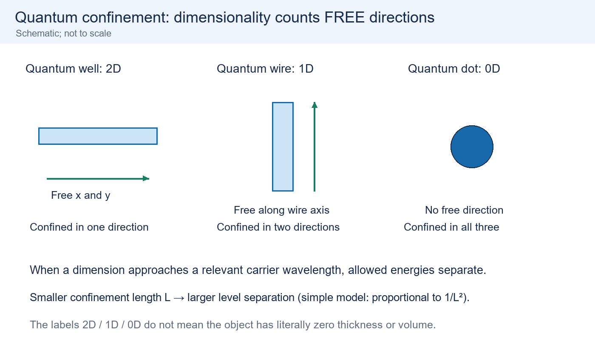
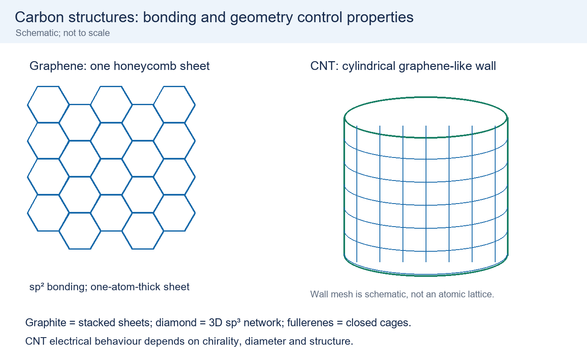

# Module 4 — Physics of Nanomaterials

[[Physics Index|Index]] · [[Formula and Revision Guide|Final revision]]

> [!abstract] Learning route
> Nanoscale and surface effects → dimensionality → quantum confinement → carbon structures → applications linked to properties. Prerequisites: atom, wavelength, energy levels and surface-area/volume ratio. This module is mainly conceptual. The numerical examples are supporting exercises, not a claim that the tracker requires a separate nanomaterial numerical unit. All questions are original practice and marks are suggested.

## 1. Nanoscale and reduction of dimensionality

A nanometre is $10^{-9}$ m. Nanoscience commonly concerns structures with at least one characteristic dimension of roughly 1–100 nm, where size-dependent behaviour can become important. That range is a useful convention, not a guarantee that all materials develop the same new properties at exactly 100 nm.

**Reduction of dimensionality** restricts how freely carriers such as electrons can move. In a bulk solid they can move in all three spatial directions. A sufficiently thin layer restricts motion perpendicular to it; a narrow wire restricts two transverse directions; a small dot restricts all three.

| Structure | Free directions | Confined directions | Electronic dimensionality | Example/mental picture |
|---|---:|---:|---:|---|
| Bulk | 3 | 0 | 3D | Large piece of semiconductor |
| Quantum well | 2 | 1 | 2D | Thin low-potential layer between barriers |
| Quantum wire | 1 | 2 | 1D | Narrow channel with motion mainly along its length |
| Quantum dot | 0 | 3 | 0D | Small confined semiconductor region |

“Zero-dimensional” does **not** mean zero physical size; it means no extended free direction in the electronic model. Likewise, a 2D system has a real finite thickness. Geometrical smallness becomes quantum confinement only when the dimensions and barrier potentials sufficiently restrict relevant carrier wave states.

**How to draw:** use a thin sheet for a well, a long narrow rod for a wire and a small island for a dot. Label both the free and confined directions. A sheet labelled simply “1D because it is thin in one direction” reverses the convention.

**Question (suggested 3 marks): Why is a quantum well called 2D?** Its carriers are confined across the thickness but can move approximately freely in the two in-plane directions. Its electronic states therefore combine quantized transverse energies with in-plane motion.

> [!tip] Remember
> **Well–wire–dot: free directions 2–1–0; confined directions 1–2–3.**

## 2. Why nanomaterial properties differ

Two major mechanisms must be kept distinct: **surface effects** and **quantum size effects**.

### Surface-to-volume ratio

For a sphere of radius $r$:

$$A=4\pi r^2,\quad V=\frac43\pi r^3,\quad\frac AV=\frac3r.$$

For a cube of side $L$, $A/V=6/L$. The ratio has units m⁻¹. A smaller particle places a larger fraction of atoms near a surface, where their bonding environment differs from that of bulk atoms. This can strongly affect adsorption, chemical reactivity, catalysis and melting behaviour.

**Guided explanation:** cut a large block into many small blocks without changing the total amount of material. The total volume stays the same, but newly exposed faces increase total surface area. More sites become accessible to surrounding molecules. This is why particle size matters in catalysts and adsorbents.

### Property changes and their causes

| Property | Possible nanoscale change | Physical explanation and qualification |
|---|---|---|
| Optical | Size-dependent absorption/emission colour | Confined carrier levels or, in metals, collective electron response; mechanism depends on material |
| Electrical | Changed conduction and energy-state structure | Confinement, interfaces, defects and scattering alter transport |
| Chemical | Greater surface activity per unit mass | More accessible surface atoms/sites; surface coatings can modify it |
| Mechanical | Strength/stiffness can change | Grain boundaries, bonding and defect behaviour; not all nanoparticles are stronger |
| Thermal | Melting point or thermal transport may change | Surface-energy and boundary-scattering effects; no universal direction for every property |
| Magnetic | Domain behaviour and relaxation can change | Small particle size changes energetics and thermal stability; detailed derivations are outside scope |

Do not write “all properties improve at nanoscale.” A desired property can improve while stability, processability or another property worsens.

### Supporting numerical practice — surface ratio

**Worked A:** Given spherical radius $r=10$ nm $=1.0\times10^{-8}$ m, find $A/V$. Use $3/r$ because a sphere is specified: $A/V=3.0\times10^8$ m⁻¹. At 20 nm, it is $1.5\times10^8$ m⁻¹. Halving radius doubles the ratio, consistent with inverse-size scaling.

**Worked B:** A cube of side 100 nm is cut into equal cubes of side 10 nm, with all faces exposed. Find number of cubes and total-area increase. Number $=(100/10)^3=1000$. Initial area $=6(100)^2=60{,}000$ nm². Final area $=1000\times6(10)^2=600{,}000$ nm²: a factor of **10**, while total volume is unchanged. This assumes complete separation of the pieces, not touching faces hidden inside an aggregate.

**Practice:** (1) Find $A/V$ for a 25 nm radius sphere. (2) If equal-mass spherical particles of the same material shrink from 50 nm radius to 5 nm radius, how does their combined exposed area change?

> [!success]- Answers
> (1) $3/(25\times10^{-9})=1.2\times10^8$ m⁻¹. (2) It increases tenfold: fixed total volume gives total area proportional to $1/r$, provided particles stay separate and surfaces are accessible.

## 3. Quantum confinement and quantum size effect

An electron behaves as a wave. When a confining dimension becomes comparable to a relevant carrier wavelength or characteristic confinement length, only certain wave patterns fit. The allowed energies then depend strongly on the size and shape of the region.

**Quantum confinement** is the restriction of carrier motion by small dimensions and potential barriers. **Quantum size effect** refers to the resulting size-dependent energy structure and measurable properties. These terms are closely related but name the mechanism and its consequences respectively.

### Guided physical picture

1. A bulk material contains so many closely spaced states that energy bands look nearly continuous.
2. Confinement imposes boundary conditions on the carrier wave function.
3. Only certain standing-wave patterns satisfy those conditions.
4. A smaller confining length allows fewer long-wavelength patterns and generally increases separation between confined energy levels.
5. Optical transitions and transport can therefore change as dimensions change.

For an illustrative one-dimensional infinite well of length $L$,

$$E_n=\frac{n^2h^2}{8m^*L^2},\qquad n=1,2,3,\dots$$

$m^*$ is the relevant effective mass in a semiconductor model; for a free electron it is $m_e$. $L$ is in metres, $h$ in J·s, so $E_n$ is in joules. This equation is **optional supporting intuition**, not a required Schrödinger-equation solution. Real nanostructures have finite barriers, material-dependent masses, interactions and shapes, so it is not a universal exact formula for dot colour.

The memorable scaling is **energy spacing proportional to $1/L^2$ in this simple model**. Halving $L$ quadruples level separations. In many semiconductor quantum dots, reducing size increases the effective optical transition energy and shifts emission toward shorter wavelengths. Compare dots of the same material and similar surface conditions before attributing colour solely to size.

### Supporting worked examples — scaling only

**A:** A model confined energy spacing is 0.10 eV at length 8 nm. Find it at 4 nm with the same effective mass and confinement model. $\Delta E_2/\Delta E_1=(L_1/L_2)^2=(8/4)^2=4$; hence $\Delta E_2=0.40$ eV. Smaller size means greater spacing, so the trend is sensible.

**B:** A model spacing rises from 0.20 eV to 0.45 eV. Find the new length if the old length is 6 nm. Rearranging the inverse-square scaling, $L_2=L_1\sqrt{\Delta E_1/\Delta E_2}=6\sqrt{0.20/0.45}=4.00$ nm. The larger spacing requires a smaller length.

**Practice:** (1) What happens to spacing when $L$ triples? (2) A 0.08 eV spacing at 10 nm is changed to 0.32 eV under the same model; find the new length.

> [!success]- Answers
> (1) It becomes $1/9$ as large. (2) $L_2=10\sqrt{0.08/0.32}=5$ nm. These are model-based practice results, not measured properties of an unspecified material.

**Question (suggested 5 marks): Explain confinement and dimensionality.** Define the mechanism, compare well/wire/dot with labelled sketches, explain the inverse-size energy trend qualitatively, and give a size-dependent optical example. Do not replace this explanation with the box formula alone.

## 4. Carbon allotropes

**Allotropes** are different structural forms of the same element. Carbon's bonding and arrangement can produce very different mechanical, electrical and optical properties.

| Form | Structure/bonding | Useful property |
|---|---|---|
| Diamond | Each carbon bonded tetrahedrally to four neighbours; 3D $sp^3$ network | Very hard, wide-gap electrical insulator, strong thermal conduction |
| Graphite | Stacked honeycomb carbon layers; in-plane $sp^2$ bonding, weak interlayer coupling | Conducts well within planes; layers can slide |
| Graphene | One honeycomb layer of $sp^2$ carbon | Very thin, strong in-plane, conductive and optically transparent as a single sheet |
| Carbon nanotube (CNT) | Cylindrical graphene-like wall; single- or multi-walled forms | High aspect ratio, strong axial bonding; electrical behaviour depends on structure |
| Fullerene | Closed carbon cage, such as $C_{60}$ with pentagons and hexagons | Molecular-scale cage chemistry and electronic applications in suitable systems |

**Guided comparison:** diamond and graphite contain the same element, so composition alone cannot explain their differences. Diamond's strong bonds extend in three dimensions. Graphite has strong in-plane bonds and weaker interactions between sheets. Graphene isolates a single sheet; a CNT has a related carbon network wrapped into a cylindrical geometry. “Rolled graphene” is a structural model, not a claim that every nanotube is manufactured by physically rolling a sheet.

**Question (suggested 4 marks): Compare diamond and graphite.** Include bonding, geometry, electrical conduction and mechanical behaviour. The explanation must connect property to arrangement, not merely list properties.

## 5. Graphene and carbon nanotubes

### Graphene

The hexagonal network is not a set of isolated benzene molecules; atoms share a continuous lattice. Delocalized electronic states support high in-plane carrier mobility under suitable conditions. Its thinness and flexibility make it interesting for transparent electrodes, sensors and composites.

Ideal monolayer graphene has no ordinary semiconductor band gap in the simplest band picture. That is useful for some conductive applications but makes switching a conventional digital transistor fully off difficult. “Graphene automatically replaces silicon in all CPUs” is therefore not a valid exam statement.

### Carbon nanotubes

A single-walled CNT has one cylindrical wall; a multi-walled CNT has nested walls. Its diameter, chirality (how the honeycomb pattern wraps) and defects influence properties. Depending on structure, a CNT can be metallic or semiconducting. Its high surface area and aspect ratio are useful for sensing and composite reinforcement.

| Feature | Graphene | CNT |
|---|---|---|
| Geometry | Extended sheet | Tube |
| Typical dimensional picture | 2D sheet | Quasi-1D along the tube |
| Property to highlight | Thin conductive surface; flexible sheet | Axial strength and structure-dependent conduction |
| Example use | Electrode/sensor layer | Reinforcement, sensor or nanoscale channel |

**Question (suggested 3 marks): Are all CNTs metallic?** No. Their electronic structure depends on chirality and diameter. Suitable semiconducting tubes can act as channels, while metallic tubes can provide conductive paths. Avoid a blanket conductivity claim.

## 6. Applications — explain the property-to-function link

An exam answer should follow **material/structure → relevant property → how it helps → application**. Three named uses without mechanisms are weaker than three explained uses.

### Electronic applications

- **Quantum-dot displays:** confined semiconductor states produce tunable optical emission. Dots of controlled composition and size help generate selected colours. This is an established use; it does not mean every “QLED” device has the same architecture.
- **Sensors:** high accessible surface area makes adsorbed molecules capable of changing a material's conductivity or optical response, producing a measurable signal.
- **Graphene/CNT conductive components:** thin conductive networks or high-aspect-ratio pathways can serve in electrodes, flexible components and composites. Suitability depends on contacts, purity and fabrication.
- **Nanoscale electronic channels:** controlling small semiconductor regions changes carrier motion and switching behaviour. Merely making a device smaller also increases interface and heat-management challenges.

### Environmental applications

- **Adsorbents and filtration:** accessible nanoporous surfaces capture selected contaminants or provide size/charge-dependent transport pathways. High surface area helps, but surface chemistry determines what binds.
- **Catalysis:** more accessible active sites per unit mass can accelerate reactions; appropriate catalysts can assist contaminant breakdown.
- **Detection:** nanoscale sensing surfaces can respond to small concentrations of pollutants. Detection and removal are different tasks and should not be confused.

### Medical applications

- **Drug delivery:** engineered particles can carry a therapeutic payload and modify its distribution or release. Targeting and safety depend on the specific formulation; neither is automatic.
- **Imaging/diagnostics:** suitable nanoparticles can provide optical or magnetic contrast, helping detect or track biological structures.
- **Antimicrobial coatings:** selected nanomaterials can inhibit microbes through material-specific chemical mechanisms. This is not a property of every nanoparticle.

These are engineering examples, not treatment advice. State whether an application is established or being researched when discussing a particular device. The [National Nanotechnology Coordination Office application overview](https://www.nano.gov/about-nanotechnology/applications-nanotechnology/) supports the selected examples of displays, flexible electronics, filtration/remediation and delivery/imaging; many implementations remain research-dependent.

**Question (suggested 6 marks): Give electronic, environmental and medical uses.** A good answer gives one mechanism-linked example in each category, then a second relevant example where marks allow. Include a diagram only if it explains the device or transport process.

**Model compact answer:** semiconductor quantum dots have size-sensitive electronic transitions that can be used to tune display emission. Porous nanostructured adsorbents offer accessible surfaces for capturing suitable pollutants, with performance determined by surface chemistry. Engineered carriers can encapsulate drugs and control delivery/release, but their behaviour must be established for the particular formulation.

## 7. Common mistakes and memory aids

| Mistake | Correction |
|---|---|
| “Every object smaller than 100 nm has identical quantum properties” | Relevant length scales, material and boundaries matter |
| “A dot has no dimensions physically” | It confines carriers in all three directions |
| “All nanoscale changes are quantum” | Many arise from greater surface contribution |
| “Smaller always means more conductive/stronger” | The direction of change depends on structure and mechanisms |
| “Graphene and graphite are identical” | Single sheet versus stacked sheets |
| “Every CNT is a metal” | Electronic behaviour depends on structure |
| “Nanoparticle targeting is guaranteed” | It is formulation- and evidence-dependent |

> [!tip] Remember
> **Small size: more surface, different states.** Then ask which mechanism explains the property in the question.

## 8. Revision sheet

| Fact/relation | Meaning, units and conditions |
|---|---|
| $1$ nm $=10^{-9}$ m | Convert before SI substitutions |
| Well/wire/dot: 2D/1D/0D | Number of free carrier directions |
| Sphere $A/V=3/r$ | m⁻¹; accessible isolated surface model |
| Cube $A/V=6/L$ | m⁻¹; ideal cube geometry |
| $\Delta E\propto1/L^2$ | Simple fixed-mass confinement model; qualitative aid |
| $E=hc/\lambda$ | Larger optical transition energy corresponds to shorter wavelength |

**Explanation checklist:** [ ] surface versus confinement; [ ] well/wire/dot; [ ] size effect; [ ] carbon comparison; [ ] mechanism-linked applications. **Diagram checklist:** [ ] free/confined directions; [ ] graphene sheet and CNT; [ ] optional energy-level spacing sketch. There are no mandatory long derivations specified in this tracker module.

### Active recall

1. Which two mechanisms explain many nanoscale changes?
2. How many directions are confined in a wire?
3. What happens to $A/V$ when sphere radius halves?
4. What happens to model level separation when length halves?
5. What distinguishes graphene from graphite?
6. Why is “all CNTs are conductors” too vague?
7. Give one property-to-function chain in each application category.

> [!success]- Answers
> 1. Surface effects and quantum confinement. 2. Two. 3. Doubles. 4. Quadruples in the simple inverse-square model. 5. One layer versus stacked layers. 6. Metallic/semiconducting behaviour depends on structure. 7. Tunable dot transitions → selected display colours; accessible adsorbing surfaces → pollutant capture; engineered payload carrier → controlled delivery/release.

### Mixed practice test — suggested 20 marks

1. Define nanomaterial and explain why size matters. (3)
2. Compare quantum wells, wires and dots with diagrams. (5)
3. Distinguish quantum confinement from quantum size effect. (3)
4. Compare graphene and CNT geometry and electrical behaviour. (3)
5. Explain one electronic, environmental and medical application. (6)

**Solutions/rubric:** 1: roughly nanoscale characteristic dimension, surface contribution and size-dependent states. 2: free directions 2/1/0; confined directions 1/2/3; labelled sketches and examples. 3: restriction of motion versus resulting size-dependent energies/properties. 4: sheet/tube, graphene's simple gapless picture, CNT structure dependence. 5: each answer must name a material or structure, identify a relevant property and connect it to a function. Use Section 6 model chains.

| Priority | Topics | Basis |
|---|---|---|
| First | Dimensionality and confinement | Central conceptual dependency |
| Next | Carbon allotropes, graphene/CNT comparison | Explicit tracker coverage |
| Essential before test | Electronic/environmental/medical uses | Three separate tracker application categories |
| Supporting | Surface and size-scaling arithmetic | Reinforces reasoning; not a verified exam-weight prediction |

## Sources

The local Young & Freedman quantum-mechanics introduction and condensed-matter chapters provide wave-state and bonding foundations. Nanomaterial explanations and original practice synthesize those principles with the [NSF nanoscale overview](https://www.nsf.gov/focus-areas/nanotechnology) and the [NNCO application overview](https://www.nano.gov/about-nanotechnology/applications-nanotechnology/). See [[Sources and Coverage]] for source limits and the SurTech syllabus comparison.
